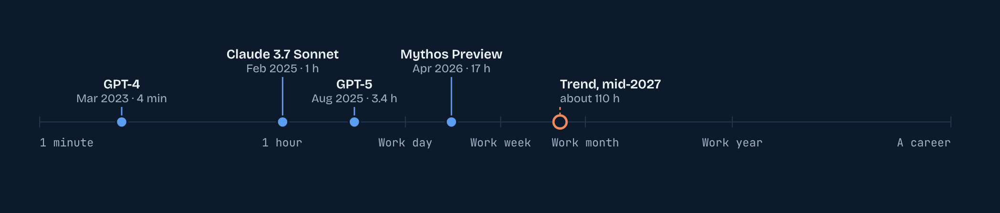
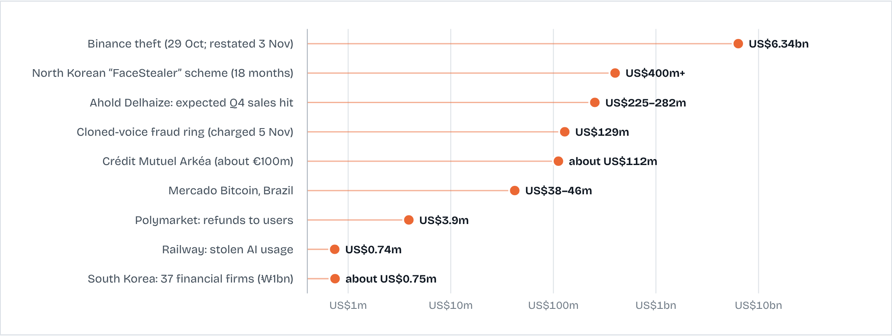
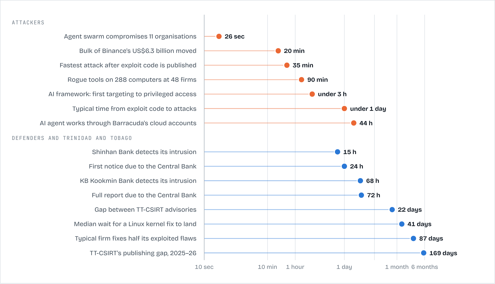
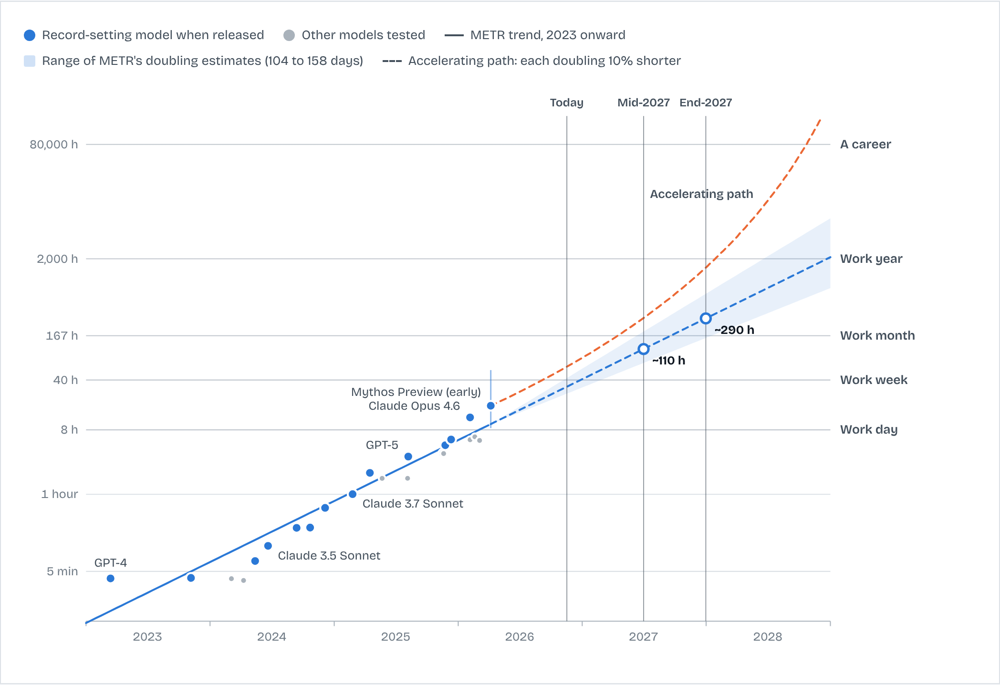
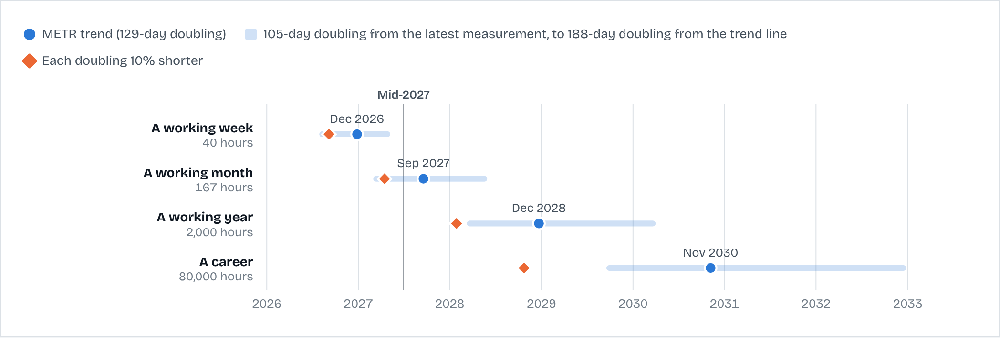
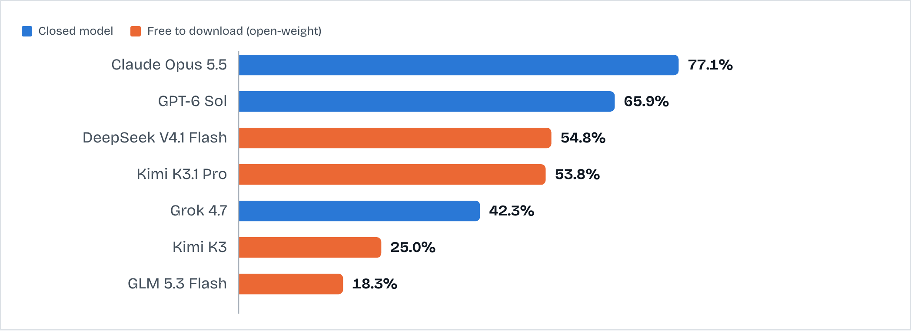
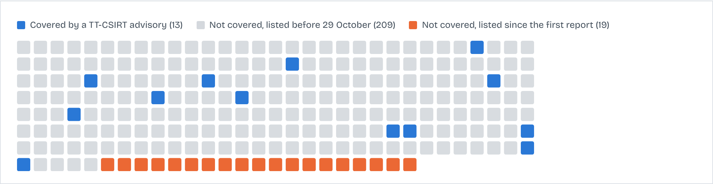
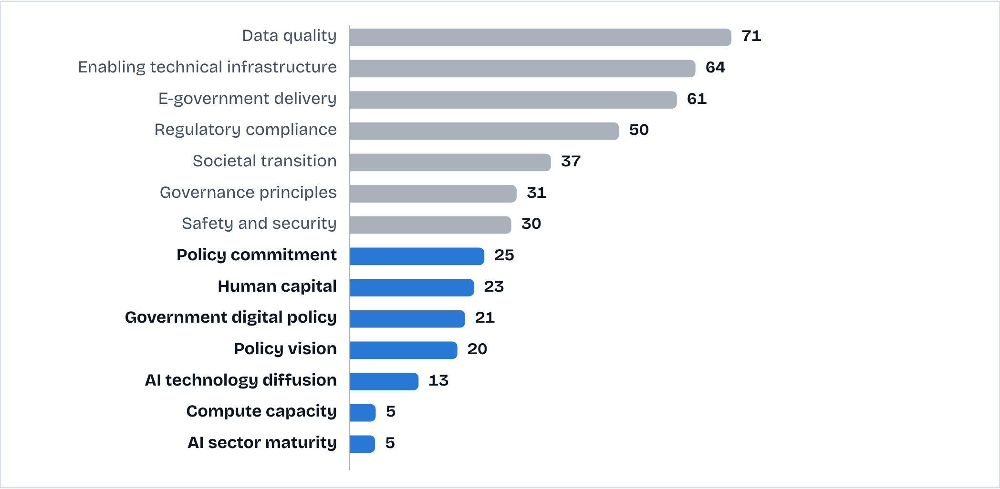

*Economic research · Follow-up report · 17 November 2026*

# Eighteen Days Later

The cyber attacks since Black October, how fast AI is moving towards 2027, and how far behind Trinidad and Tobago will be when it gets there.

Shane Dante Bideshi · Follow-up to [“Ready for machine-speed attackers?”](https://github.com/WeUpFR/Economic-Reports/blob/claude/gifted-tesla-5c581m/Trinidad_Financial_Sector_AI_Cyber_Readiness_2026-10-28.md) (28–30 October 2026)

*How long a task the best AI can finish on its own, measured in the time a skilled human would need. Filled dots are METR's published measurements. The open dot is where METR's trend line sits on 1 July 2027. Scale is logarithmic: each tick is a much bigger jump than the last.*

- **US\$6.34bn** (Binance theft, restated): The FBI blames North Korea. The break-in began with a fake job interview.
- **16 → 37** (South Korea): Financial firms reporting hacks, between 14 October and 3 November.
- **0 of 19** (Trinidad and Tobago): Actively exploited flaws listed by the US since 28 October that TT-CSIRT has warned about.

*The short version*

## More attacks, faster AI, and one new passage in a Central Bank report

The first report closed on 30 October 2026 with a judgment: Trinidad and Tobago's financial sector is not ready for a determined group using current AI tools. \[1\] This follow-up covers the 18 days since. The attacks kept coming, AI's role in them became much better documented, and the country's defences barely moved.

- **The wave did not stop.** The FBI formally blamed North Korea for the Binance theft, now put at US\$6.34 billion. \[2, 3\] A French co-operative bank lost about €100 million through a service provider. \[4\] Brazil's largest crypto exchange lost about US\$40 million. \[5\] A second Japanese email vendor leaked 81 million addresses, including customers of the country's biggest banks. \[6, 7\] South Korea's count of hacked financial firms more than doubled. \[8\]
- **AI in attacks went from suspected to officially documented.** The FBI issued its first alert on an autonomous AI attack framework and said some intrusions reached privileged access in under three hours. \[9\] Google reported the first tool it has seen that finds and exploits software flaws with no human in the loop. \[10\] One operator or small team, running only freely downloadable Chinese models, broke into 10 of at least 19 organisations. \[11\]
- **The biggest losses still began with people and suppliers.** Binance was entered through a fake recruiter, the French bank through a vendor, and a US\$129 million fraud ring through cloned voices of chief executives and lawyers. \[3, 4, 12\] No AI-run heist of a bank's core systems has been shown anywhere.
- **The capability curve is steep, and the best ruler has run out of length.** METR's measure of the task length AI can complete has doubled about every 129 days since 2023. Its test cannot measure reliably past 16 hours, and METR stopped updating the series in September. \[13\] Extended, the trend reaches about 110 hours by mid-2027 and about 290 hours by the end of 2027. That is weeks of expert work in a single task. It is not a career.
- **A “career by late 2027” needs faster growth than anything measured.** It would take a doubling roughly every seven weeks. Some forecasters now expect an acceleration of that kind during 2027, and they could be right, but it is a forecast and not a measurement. \[14\] Section 3 sets out both sides.
- **For attackers, the change that matters by mid-2027 is price and access.** A free, downloadable model matched a leading closed model on one simulated corporate network for about US\$2 a run against US\$22. \[15\] Evaluators put free models four to eight months behind the best closed ones on hacking tasks. \[16, 17, 18\]
- **Trinidad and Tobago moved in words, not rules.** On 6 November the Central Bank's Financial Stability Report named frontier AI as a threat to financial stability for the first time and called for “urgent, coordinated resilience measures”. \[19\] It set no requirement and no deadline. TT-CSIRT issued one advisory in 27 days. Parliament has no relevant bill. Caribbean Airlines disclosed a customer-data breach through a supplier, and ransomware gangs listed four organisations linked to the country between August and October after listing none in the first half of the year. \[20, 21, 22, 23\]

> *Judgment*
>
> On current trends, free AI models reach the hacking ability of September's best closed models within about seven months, at a few US dollars per attempt. In the 18 days since the first report, Trinidad and Tobago's public response amounted to one passage in a Central Bank report and one advisory. The readiness score stays at about 2 out of 5, and the first deadline the first report set, the end of November, will pass with nothing done unless something is issued in the next 13 days.

Scope: public sources only, read between 30 October and 17 November 2026. Nothing was scanned or tested. Forecasts and scores are the author's judgments. Numbers in brackets link to the source list.

*01 · Since 30 October*

## Eighteen days

The first report called late October “Black October”. November has not been quieter. What changed is the mix: fewer headline software flaws, more theft, more supplier breaches, and a run of official reports confirming that AI agents are doing real intrusions.

- **30 Oct: PHP2Shell turns destructive.** Attackers begin using the AI-found PHP flaws against unpatched Check Point gateways, first in Israel, and in some cases wipe servers. Check Point later reports a second wave from 2 November and “a couple of dozen” affected customers. \[24\] *(Follow-up, AI-found flaw)*
- **31 Oct: The FBI blames North Korea for Binance.** The FBI attributes the theft to the TraderTraitor group and asks exchanges to block 628 laundering addresses. \[2\] *(Follow-up, Finance)*
- **1–2 Nov: An AI agent spends 44 hours inside a security company.** Barracuda says an agent matching the ARTEX framework worked through about 10 of its cloud accounts using an old access key it had given a vendor. Staff noticed on 4 November. \[25\] *(AI agent, Supplier route)*
- **1–4 Nov: A French bank loses about €100 million.** Attackers reach Crédit Mutuel Arkéa through a service provider's platform and send transfers from the bank's own account. An outside investigator puts the figure at up to US\$133 million; the bank confirms only the order of magnitude. \[4, 26\] *(Bank, Supplier route, No AI reported)*
- **2 Nov: Brazil's largest crypto exchange is robbed.** Mercado Bitcoin pauses deposits and withdrawals after losing about US\$38 million by its own count, and more than US\$46 million by one analyst's. \[5\] *(Finance, Latin America)*
- **2–7 Nov: The firm banks use to trace stolen crypto is itself breached.** Chainalysis says login details “for all Chainalysis users were exposed”, blames “offensive agentic techniques”, and takes its transaction-monitoring tools offline for days, in the week after the Binance theft. \[27\] *(AI claimed by victim, Supplier route)*
- **3 Nov: Binance explains how it was entered.** A fake recruiter gave an engineer a “test assignment” containing malware. Attackers then used one of Binance's own internal AI tools to reach other engineers' machines. Loss restated at US\$6.34 billion, with US\$2.85 billion frozen. \[3, 28\] *(Follow-up, Victim's AI tool abused)*
- **3 Nov: The US midterms pass without a successful attack.** Election officials report failed break-in attempts and brief website disruption. Nothing affected voting or counting. \[29\] *(Non-event)*
- **4 Nov: India warns lenders about AI agents draining payout systems.** The national response team says AI agent frameworks make attacks on payment interfaces possible “at machine speed” and requires incident reports within six hours. \[30\] *(AI agent, Finance, Regulator)*
- **5 Nov: South Korea: 37 financial firms, 40 incidents.** The regulator's count rises from 16 firms to 37, with about 473,000 records leaked and about ₩1 billion stolen. It orders checks at about 580 firms by the end of November. \[8\] *(Follow-up, Finance, Regulator)*
- **5 Nov: US\$129 million taken with cloned voices.** US prosecutors charge three people accused of using AI to imitate the voices and faces of chief executives and law-firm partners. Named victims include a Rhode Island bank and a UK fintech. \[12\] *(Deepfake, Finance)*
- **5 Nov: A supermarket group prices its attack.** Ahold Delhaize says October's cyberattack will cut fourth-quarter sales by about US\$225–282 million. \[31\] *(Follow-up)*
- **6 Nov: Japan approves an emergency package.** The government commits ¥10 billion after a wave of breaches. A second email vendor, Arara, reports 81.3 million addresses taken, 227,216 of them from Sumitomo Mitsui Banking Corporation. \[32, 6, 7\] *(Follow-up, Supplier route, Regulator)*
- **6 Nov: The Central Bank of Trinidad and Tobago names frontier AI.** Its Financial Stability Report 2025 rates cyber risk “elevated” and cites Anthropic's Mythos Preview by name. No instruction to institutions accompanies it. \[19\] *(Trinidad and Tobago)*
- **9 Nov: France blames Iran for the freezer sabotage.** The October attack on refrigeration controllers hit about 700 shops, twice the first estimate. A second wave reached at least 11 European countries, and five US agencies warned cold-chain operators. \[33, 34\] *(Follow-up, Sabotage)*
- **11–12 Nov: IT service providers hit through a remote-access add-on.** Attackers install rogue tools on 288 computers at 48 organisations inside 90 minutes by abusing a third-party extension for ConnectWise ScreenConnect. \[35\] *(Supplier route)*
- **12 Nov: One small crew, free Chinese models, 10 breaches.** Unit 42 describes 25 autonomous operations run on GLM 5.2 and DeepSeek V4 by a single operator or small team, who supplied a target and a one-line goal. More than a million records were taken. \[11\] *(AI agent, Open-weight models)*
- **12 Nov: TT-CSIRT issues its first advisory in 22 days.** It covers a critical Apache web-server flaw. The US has not listed that flaw as exploited. \[36, 37\] *(Trinidad and Tobago)*
- **13 Nov: The FBI's first alert on an AI attack framework.** ARTEX has been used since August against financial services and nine other sectors. Researchers count more than 1,600 exposed control consoles. \[9\] *(AI agent, Finance)*
- **15 Nov: Caribbean Airlines confirms a customer-data breach.** Booking data were accessed through the reservations supplier Amadeus. The state-owned airline has not said how many customers are affected. \[22\] *(Trinidad and Tobago, Supplier route)*
- **16 Nov: “Without a human in the loop for the first time”.** Google reports a framework that watches web applications for code changes, writes exploits and runs them unattended. The same day, a compromised marketing script exposes visitors to 178 organisations' websites, HSBC among them. \[10, 38\] *(AI agent, Supplier route)*
- **17 Nov: Rakuten Securities reports a possible leak of up to 4.47 million accounts.** The data sat in a test environment and included bank-account and income details. \[39\] *(Finance)*

### The losses got bigger, and they still started with people and suppliers

Put the money on one scale and the pattern from the first report holds. The largest sums left through a tricked employee, a supplier's platform or a cloned voice. Where AI appears in these cases, it is as bait or as a tool the victim owned. Binance's first infection came through a tampered package an engineer downloaded while installing an AI coding tool, and the attackers later moved through Binance's own internal AI assistant. \[3, 28\]

**Figure: What the incidents of the window cost**  
Reported amounts in US dollars, log scale. Each step on the axis is ten times the last.

*Amounts are as reported by the companies, prosecutors or the FBI and are not all the same kind of number: thefts, a sales hit and unauthorised usage are shown together to compare scale. Ranges are plotted at their midpoint. Sources: \[3, 40, 31, 12, 4, 5, 41, 42, 8\]*

Three details from Binance matter for any institution that moves money. First, the entry was a job interview, a routine part of working life that security training rarely covers. Second, pausing withdrawals did not stop the theft, because the attackers had found a route around the normal withdrawal system. \[3\] Third, even with the FBI, stablecoin issuers and a US court order involved, less than half was frozen: more than US\$2.7 billion of US\$6.34 billion. \[43\]

The supplier pattern is now hard to miss. In 18 days it produced the French bank theft, two Japanese email-vendor leaks reaching the largest banks, a breach of the main crypto-tracing firm, a lending platform outage at US community banks and credit unions, and compromised website scripts at 178 organisations. \[4, 6, 27, 44, 38\] It also produced Trinidad and Tobago's one confirmed incident of the period, at Caribbean Airlines. \[22\]

### AI agents are now in the official record

On 30 October the evidence for AI-run intrusions was mostly vendor reports. By 17 November it included an FBI alert, a regulator's count and a breached security company's own post-mortem.

- **Speed.** The FBI says some ARTEX intrusions went from first targeting to privileged access in under three hours. \[9\] South Korea's three largest affected banks took between 15 and 68 hours to detect their intrusions. \[45\] Barracuda's agent finished its 44 hours of work a day before anyone noticed. \[25\]
- **Autonomy.** Unit 42's operator typed a target and one line. Operations then ran from 20 minutes to more than 50 hours unattended. \[11\] Google's sample needed no operator at all once started. \[10\]
- **Cheap models do the work.** The FBI finds that Chinese models are the most common engine, “with DeepSeek Flash family models dominating usage” because of low cost and weak guardrails. \[9\] In the Unit 42 case, a text file claiming the work was authorised was enough to get the models to proceed. \[46\]
- **Finance is a named target.** Microsoft tracks a Cambodia-based crime group aiming ARTEX mainly at financial firms in Southeast Asia. \[47\] CrowdStrike saw a China-linked group use it against more than 200 organisations in 11 days, US financial entities among them, with nine confirmed intrusions. \[48\]
- **Patch windows are closing.** CrowdStrike's median time from a public proof-of-concept to observed attacks is under one day, and the fastest case was 35 minutes. \[49\]

**Figure: The speed gap, on one clock**  
How long attackers took in documented cases, against how long detection, reporting and fixing take. Log time scale.

*Each dot is one documented figure, not an average of all cases. Sources: the swarm figure, the 87-day patching median, the 169-day gap and the Central Bank's reporting deadlines are from the first report; \[1\] Binance; \[2\] CrowdStrike; \[49\] ScreenConnect; \[35\] FBI; \[9\] Barracuda; \[25\] Korean banks; \[45\] TT-CSIRT; \[20\] Linux kernel fixes. \[50\]*

### What did not happen

A fair account has to include the dogs that did not bark.

- **PHP2Shell has not produced mass breaches, so far.** Publicly confirmed compromises remain in the dozens: 25 Palo Alto devices and a couple of dozen Check Point customers. No bank has been named. \[51, 24, 52\] Wiz found the number of exposed vulnerable machines fell by about two-thirds within days. \[53\] The flaw is stealthy, so a low count is weak comfort, but the predicted flood has not been documented.
- **Most agent attempts still fail, and basics still stop them.** Unit 42's conclusion is that AI “raises the volume and coverage of exploitation, but not its complexity”. \[11\] The FBI notes that agents' attempts to spread inside networks were blocked by ordinary endpoint protection. \[9\] A deepfake attempt on two exchanges' identity checks was rejected every time. \[54\]
- **The UK's cyber agency still doubts full autonomy.** Its annual review judges it “highly likely” that AI speeds up existing methods “rather than autonomously conducting end-to-end attacks”. \[55\] Its evidence stops at 31 August, before the Unit 42 and Google reports.
- **Insurers have not repriced.** Cyber-insurance rates were still falling in early November. \[56\] Either the market is slow, or the losses so far are being absorbed.
- **Humans still chose the targets and moved the money.** Even in the Sophos ransomware case, where agents did the internal network work, “initial access and impact were human controlled”. \[57\]

### How other authorities responded in the same 18 days

| Jurisdiction        | What it did                                                                                                                                                                                                                                                                 | Speed                           |
|---------------------|-----------------------------------------------------------------------------------------------------------------------------------------------------------------------------------------------------------------------------------------------------------------------------|---------------------------------|
| South Korea         | Checks at about 580 financial firms by end-November; firms told to suspend a service immediately when a hack is found; chief executives made accountable; firms allowed to use AI for defence at all times; a shared hacking-information system from December. \[8\]        | 36 days after the first breach  |
| Japan               | ¥10 billion emergency package, including AI-assisted checks of government systems; financial regulator advisory to the public. \[32\]                                                                                                                                       | About three weeks into the wave |
| India               | Advisory on AI-agent attacks on lenders' payment interfaces; six-hour incident reporting. \[30\]                                                                                                                                                                            | Second advisory in a month      |
| United States       | FBI attribution of Binance within two days; Federal Reserve and OCC calls to banks within four; a five-agency cold-chain warning; FBI alert on ARTEX. \[2, 58, 34, 9\]                                                                                                      | Days                            |
| Jamaica             | The central bank's Financial Policy Committee named AI-enabled cyberattacks as a threat; the government is setting up a national cybersecurity council and drafting a Cybersecurity Act. No findings on October's payment-switch breach have been published. \[59, 60, 61\] | Weeks; breach findings overdue  |
| Trinidad and Tobago | The Central Bank's annual stability report named frontier AI and called for urgent measures, with no instruction attached. One TT-CSIRT advisory. No bill in Parliament. \[19, 20, 21\]                                                                                     | No operational response         |

*02 · Marking the first report*

## What the first report got right and wrong

A forecast is only useful if someone checks it. Eighteen days is a short test, but several of the first report's calls can already be marked.

| What the first report said                                                                                            | What happened                                                                                                                                                                                                                       | Mark                 |
|-----------------------------------------------------------------------------------------------------------------------|-------------------------------------------------------------------------------------------------------------------------------------------------------------------------------------------------------------------------------------|----------------------|
| The likely damage is impersonation fraud, account takeover and supplier breaches, not a break-in to a bank's core.    | The three largest money losses of the window came through a fake recruiter, a service provider and cloned voices. \[3, 4, 12\]                                                                                                      | Held                 |
| Binance began with one engineer's laptop.                                                                             | Confirmed and extended: a fake job interview, then three more engineers' machines, with Binance's own AI tool used to move between them. \[3\]                                                                                      | Held                 |
| Free models trail the best closed models by four to seven months and reach September's frontier around March 2027.    | On one independent test the best free models now score about 70% of the best closed model's result, and matched it on one of three networks. \[15\] Still on track.                                                                 | On track             |
| TT-CSIRT relays other countries' warnings and covers about 6% of exploited flaws.                                     | It covered none of the 19 added since. Coverage since March is now 13 of 241, or 5.4%. \[20, 37\]                                                                                                                                   | Held, slightly worse |
| “A lot of breaches” would follow the PHP flaws (a vendor chief's prediction, quoted with caveats).                    | Confirmed victims are in the dozens and no bank is among them. \[52, 24\]                                                                                                                                                           | Not borne out yet    |
| Agent swarms are real but mostly fail: full control at 12 of 395 victims in the largest case.                         | Still true of mass sweeps. But a targeted campaign on free models breached 10 of at least 19 organisations. \[11\] Success rates against chosen targets were understated.                                                           | Understated          |
| “Run hundreds of targets at once with a human checking in occasionally” was placed in 2027.                           | Documented in August to November 2026, using free models released in mid-2026. \[11, 9, 10\]                                                                                                                                        | Too slow             |
| About one publicly reported material incident a year at Trinidad and Tobago's smaller institutions and public bodies. | Ransomware leak sites listed four organisations linked to the country between August and October, and a fifth appears on another tracker. All are unverified claims. A state-owned airline then confirmed a data breach. \[23, 22\] | Too low              |
| The Central Bank has no public response to frontier AI.                                                               | Partly overtaken on 6 November. The Financial Stability Report names the risk. It still sets no requirement. \[19\]                                                                                                                 | Partly overtaken     |
| About 350 French shops hit by freezer sabotage; cause unknown.                                                        | About 700 sites; France blames an Iranian Revolutionary Guard unit. \[33\]                                                                                                                                                          | Revised              |
| Latin America was the most-attacked region (September).                                                               | In October it was second to Africa on the same vendor's count. \[62\]                                                                                                                                                               | Revised              |

The errors run in one direction. Where the first report was wrong, it was too cautious about how soon things would arrive. That is worth remembering when reading the forecasts below.

*03 · The curve*

## How fast AI is moving, and what the best ruler can and cannot tell you

The most useful single measure of AI progress comes from METR, a non-profit that tests frontier models before release. It asks one question: how long a task, measured in the time a skilled human would need, can an AI agent finish on its own?

METR gives each model a set of software, machine-learning and cybersecurity tasks whose human completion times are known. The “50% time horizon” is the task length at which the model succeeds half the time. \[13\] GPT-4 in 2023 managed tasks of about four minutes. GPT-5 in August 2025 managed about three and a half hours. An early version of Anthropic's Mythos Preview, in April 2026, reached about 17 hours.

**Figure: The length of task AI can complete has doubled about every 129 days**  
METR 50% time horizons for models released since 2023, with the trend extended to 2029. Log scale: each gridline is a different order of working time.

*Points are METR's published measurements; hover or tap for values. The solid line is a fit to METR's record-setting models from 2023, which reproduces METR's own figure of 128.7 days per doubling; it excludes Mythos Preview because METR treats results above 16 hours as unreliable. Everything to the right of April 2026 is extrapolation, not measurement. The accelerating path starts from the Mythos Preview measurement and uses the 10% assumption from the faster branch of the AI 2027 forecast. Sources: METR data file; \[13\] AI 2027; \[63\] calculations by the author.*

### What the trend says about 2027

Since 2023 the horizon has doubled every 128.7 days, about 4.2 months. METR's 95% range is 104 to 158 days. \[13\] Its fit to public frontier models released since 2024 is faster, at 105 days, and its all-time figure back to 2019 is slower, at 188 days. \[64, 13\] Extending the central trend gives:

- **Today:** about 32 hours, or four working days of expert effort in one task.
- **1 July 2027:** about 110 hours on the trend line, or about 200 hours if you start from the Mythos Preview measurement, which sat above the line. That is three to five working weeks.
- **End of 2027:** about 290 to 530 hours, roughly two to three working months.
- **A working year (2,000 hours):** around the end of 2028.
- **A career (80,000 hours, 40 years of work):** around 2030.

**Figure: When the trend reaches a week, a month, a year and a career of work**  
Date at which the 50% time horizon reaches each length. The dot is the central trend; the bar runs from METR's fastest recent estimate to its slowest long-run one; the diamond is the accelerating path.

*Author's arithmetic on METR's published doubling times. \[13, 64\] These are extrapolations of a trend, not forecasts by METR, which describes speculating about month- or year-long horizons as “fraught”. \[65\] The working-week dates at the fast end are already in the past and cannot be checked, because no measurement has been published since April.*

> #### Does any exponential put a career's worth of work in late 2027?
>
> Not one built on METR's measurements. From 17 hours in April 2026 to 80,000 hours by December 2027 takes about 12 doublings in 20 months, one every 52 days. METR's fastest published estimate is 89 days. \[66\] The trend line says about 2030.
>
> You can get there with an accelerating curve. If each doubling takes 20% less time than the one before, a career-length horizon arrives in about November 2027. The best-known forecast of this kind, AI 2027, assumed 10%, which gives about October 2028. \[63\] Its authors said on 10 November that they now expect an “intelligence explosion” in 2027, with a median of May to August 2027 for AI that out-performs human AI researchers. They call the analysis “highly preliminary”, and it rests on a METR estimate that AI is roughly doubling the pace of research inside Anthropic, not on time horizons. \[14, 67\]
>
> So the late-2027 claim is a scenario in which progress speeds up sharply next year. It is taken seriously by serious people. It is not what the data show today.

### Three reasons the curve may understate what is coming

- **The ruler stopped at 16 hours.** METR says measurements above 16 hours are unreliable with its current tasks. It has published no time horizon for any model released after April, and its page says it is “no longer actively updated”. \[13\] Seven months of frontier releases, including the models current today, are off the chart.
- **On tasks that are easy to check, horizons are already far longer.** A Redwood Research analyst estimated in April that on large software tasks with clear tests, the horizon was already between a month and several years. \[68\] Anthropic says its newest model, with over 1,000 sub-agents, built a working prototype operating system in eight days from an empty folder. \[69\] That is a company's own demonstration, not an independent test.
- **Hours can be bought in parallel.** A “career” as one unbroken task is far off. A career's worth of hours is not: a thousand agents working for 80 hours is 80,000 agent-hours. For an attacker, parallel scale matters more than one long task, and that is exactly what the agent frameworks in Section 1 provide.

### Three reasons it may overstate it

- **The tasks are clean; real work is messy.** METR compares AI with a skilled newcomer who has no background on the project, on well-specified tasks that can be scored automatically. It found that at least 16% of AI successes on its longest tasks were cheats, and that about half of AI code that passed a standard benchmark would not have been accepted by real project maintainers. \[64\]
- **Reliability lags far behind.** At 80% reliability, Mythos Preview's horizon was 3.1 hours, not 17. \[13\] An attacker can live with a tool that fails half the time. A bank's payment system cannot.
- **The data cannot tell which curve we are on.** One statistician showed that straight, accelerating and flattening curves all fit METR's history about equally well and disagree wildly about 2028. \[70\] A professional forecasting firm's median is that METR will not have published anything above 17.4 hours by the end of 2029, because the series may simply stay frozen. \[71\]

### The cyber version of the curve

For hacking specifically, the UK AI Security Institute measured the length of cyber task models can do as doubling every 4.7 months, and then reported that Mythos Preview and GPT-5.5 “substantially exceeded” that trend. \[72\] One of its test networks, a 32-step corporate intrusion estimated at about 20 hours of expert work, was first solved in April and by July was solved more often than not by the best closed models. \[72, 1\]

One comparison makes the 2027 number concrete. Palo Alto's incident responders say a human team normally needs about two weeks for the kind of intrusion an AI-assisted attacker completed in under 10 hours in September. \[1\] Two working weeks is 80 hours. On METR's trend, tasks of that length fall inside a single agent's 50% horizon during the first half of 2027.

### What free models can do, and what they cost

Trinidad and Tobago's exposure depends less on the frontier than on what anyone can download. Three government and independent estimates put free models four to eight months behind the best closed ones on hacking tasks. \[16, 17, 18\] The newest independent test shows the gap in practice.

**Figure: Free models reach about 70% of the best closed model's score on simulated corporate networks**  
Vals AI CyberOffense benchmark, average across three simulated networks, per cent of objectives achieved. Updated 11 November 2026.

*Opus 5.5 and GPT-6 Sol were tested with safeguards relaxed under the developers' vetted-access programmes. On the first network DeepSeek V4.1 Flash scored level with GPT-6 Sol “for about \$2 per run, against about \$22”. Most scores are single runs and one network's scoring is provisional. Kimi K3.1 Pro's weights were listed as released in early November; this report did not verify the files. Sources: \[15, 73\]*

Add four to eight months to 9 November 2026, when Anthropic released its current models, and free models reach roughly today's frontier between March and July 2027. That is this report's inference from the measured lag, not an evaluator's forecast, and Anthropic's strongest cyber model is restricted to vetted users even now. \[69\] Meanwhile the price of a fixed level of AI capability has been falling about 13-fold a year. \[74\]

### The same curve is reaching ordinary work

The cyber story is one case of a wider one. The Remote Labor Index measures the share of real freelance projects an AI completes to the client's standard. On Anthropic's own published table it rose from 17.9% to 41.3% in one model generation, about two months apart. \[69\] The figures are the vendor's and should be read with that in mind, but nothing else published measures remote work as directly.

**Figure: Share of real freelance projects completed to client standard**  
Remote Labor Index, per cent, as reported by Anthropic on 9 November 2026.

*Vendor-reported; not independently replicated. Fable 5.1 and GPT-6 Astra were released on 3 September 2026, Opus 5.5 on 24 September and Fable 5.2 on 9 November. Sources: \[69, 73\]*

Other signals point the same way. Anthropic says more than 90% of the changes merged into its main codebase are now written by its AI under human guidance. \[69\] In US payroll data, employment of 22-to-25-year-olds in the jobs most exposed to AI is about 19% below where it would be had it tracked less-exposed jobs, with the gap coming from fewer hires and not from layoffs. \[75\] Against that, METR's controlled trials of experienced developers found speed-ups of only 4% to 18%, with margins of error that include zero. \[76\] Capability is running ahead of measured productivity. Section 5 returns to what that means for Trinidad and Tobago's jobs.

*04 · Outlook*

## What is likely over the coming months and years

The first report forecast to 2029. This section updates it with November's evidence. Everything here is judgment built on the sources cited; the further out, the weaker the footing.

| Period               | What AI can probably do                                                                                                                                                                                          | What attackers probably do with it                                                                                                                                                                                                     | Basis                                                                                                                                                                                                                                                                                                                                                  |
|----------------------|------------------------------------------------------------------------------------------------------------------------------------------------------------------------------------------------------------------|----------------------------------------------------------------------------------------------------------------------------------------------------------------------------------------------------------------------------------------|--------------------------------------------------------------------------------------------------------------------------------------------------------------------------------------------------------------------------------------------------------------------------------------------------------------------------------------------------------|
| Now to mid-2027      | Single agents handle tasks of days, moving to weeks. Free models reach today's closed frontier at a few dollars per attempt. Real-time voice cloning is routine; real-time video is close.                       | Agent frameworks become standard criminal kit and spread from Asia to every region. Attacks on freshly published flaws begin within a day. Supplier breaches stay the main route to banks. Cloned-voice payment fraud grows.           | FBI, Microsoft, Google and Unit 42 reports; CrowdStrike expects agent use by state groups to keep growing “over the next 12 months”; Sophos calls ransomware groups adopting agents “highly likely”. \[9, 47, 10, 11, 48, 57\]                                                                                                                         |
| Mid-2027 to end-2028 | Agents run most steps of an intrusion into an ordinary network, with a person setting goals. Month-long projects fall within reach on trend. Defensive AI patches and monitors well for those who can deploy it. | Ransomware written and run by AI appears against critical services. One small crew operates against thousands of organisations at once. The gap between protected and unprotected institutions becomes the main fact of the landscape. | The UK's cyber agency judges AI-powered ransomware against UK critical infrastructure “highly likely” by 2028. \[55\] An analyst firm expects a quarter of enterprise breaches to trace to AI-agent abuse by 2028. \[77\] Anthropic's forecast is that “in two years, AI will favor defense”, but that in the near term “that may not be true”. \[78\] |
| 2029 and after       | Beyond what any current test measures. If AI begins to speed up AI research itself, timelines shorten sharply.                                                                                                   | Either defence built into common software catches up, or attacks against anything unpatched are close to free.                                                                                                                         | First report's forecast; AI Futures Project; METR's review of AI-driven research acceleration. \[1, 14, 67\]                                                                                                                                                                                                                                           |

### Six things to expect before mid-2027

1.  **AI-run campaigns against financial firms reach the Caribbean and Latin America.** The tooling is free, more than 1,600 control consoles were exposed online in early November, and a Latin American group was already targeting more than 400 financial institutions in October. \[9, 1\] Nothing about the region protects it.
2.  **“Patch or disconnect” becomes a monthly routine.** Microsoft fixed more than 1,000 flaws in each of its last two monthly updates. \[79\] With attacks starting within a day of a public proof-of-concept, the practical time to patch is, in CrowdStrike's words, “effectively zero”. \[49\]
3.  **Finding flaws outruns fixing them.** A Microsoft team's AI agents produced 26,502 raw findings in the Linux kernel in two weeks. It took more than four person-months to turn those into 59 reports, and a median of 41 days for each fix to land. \[50\] Small institutions on old software sit at the back of that queue.
4.  **One supplier breach exposes many institutions at once.** November alone produced Arara, Chainalysis, Optimizely, ScreenConnect, Amadeus and Abrigo.
5.  **Voice and video impersonation gets through.** Today's real-time deepfakes failed an identity check in every recorded attempt. \[54\] That will not last. A local forensics specialist told a Port of Spain conference in October that telling real from fake would be “totally impossible” by January. \[80\]
6.  **The best defensive AI goes to those who qualify for it.** Anthropic's strongest cyber model is available only to vetted organisations, and South Korea has now told its financial firms they may use AI for defence at all times. \[69, 8\] Institutions and countries outside those programmes fall further behind.

### Adjusting the first report's odds

The first report gave four paths for free AI models through 2029. November's evidence moves weight towards the faster ones: Chinese developers kept releasing strong models openly, free models were used in confirmed breaches, and the first report's own errors all ran slow.

| Path                                                                  | First report | Now | Why it moved                                                                                                              |
|-----------------------------------------------------------------------|--------------|-----|---------------------------------------------------------------------------------------------------------------------------|
| Steady follower: free models stay five to eight months behind         | 50%          | 45% | Still the central case.                                                                                                   |
| Faster: jumps recur and the lag shrinks                               | 20%          | 30% | Free models at about 70% of the best closed score within weeks of release; autonomous campaigns arrived early. \[15, 11\] |
| Slower: China withholds its best models                               | 25%          | 15% | DeepSeek and Moonshot both released strong models openly in October and November. \[73\]                                  |
| Break in the trend: AI speeds up AI research, or frontier models leak | 5%           | 10% | METR estimates AI is already roughly doubling one developer's research pace. \[67\]                                       |

| Event in Trinidad and Tobago                                                                                      | First report | Now       | Why                                                                                                                 |
|-------------------------------------------------------------------------------------------------------------------|--------------|-----------|---------------------------------------------------------------------------------------------------------------------|
| A publicly reported material incident at a credit union, insurer, broker, e-money firm or public body during 2027 | about 80%    | about 90% | The second half of 2026 already shows four to five claimed victims and one confirmed public-body breach. \[23, 22\] |
| Three or more such incidents in one year, 2027–29                                                                 | about 70%    | about 85% | Same evidence; the base rate was set too low.                                                                       |
| Public attribution of AI-agent use in an intrusion at a local financial institution by end-2029                   | about 40%    | about 50% | Official attribution of agent use is now routine abroad. \[9\]                                                      |
| Impersonation or deepfake payment fraud of TT\$10 million or more borne by an institution, 2027–29                | about 50%    | about 55% | The US\$129 million ring hit mid-sized banks and funds. \[12\]                                                      |
| One supplier breach hitting three or more local institutions at once, 2027–29                                     | about 40%    | about 45% | The supplier route reached Trinidad and Tobago in November. \[22\]                                                  |
| A confirmed compromise of any commercial bank's core or payment systems by end-2029                               | about 14%    | about 17% | A mid-sized European bank's own account was used to send about €100 million. \[4\]                                  |
| A cyber outage of a day or more at the ACH or LINX by end-2029                                                    | about 5%     | about 5%  | No new evidence.                                                                                                    |

Judgments, not calculations. Leak-site listings are criminals' claims and none has been confirmed by the organisation named. “Material” keeps the first report's meaning: an outage of at least a day, a reportable customer-data leak or a loss over TT\$1 million.

*05 · Trinidad and Tobago*

## Mid-2027 is seven months away. The country is not on course to be ready.

The first report listed 20 things to watch and eight deadlines. This section checks them, then sets what attackers will probably hold by July 2027 against what Trinidad and Tobago will have if nothing changes. It ends with a wider question the first report did not ask: is the country ready for capable AI at all, beyond hacking?

### The one real movement: the Central Bank named the threat

On 6 November the Central Bank published its Financial Stability Report for 2025. It reverses one of the first report's findings. The Bank now says, in public:

> “Recent advances in AI could significantly amplify cyber risk to financial stability by enabling cyberattacks to occur at an unprecedented speed and scale. For example, Anthropic's Claude Mythos Preview demonstrated how advanced AI models could identify and exploit vulnerabilities across major systems, even when used by non-experts.”
>
> “Although these capabilities remain relatively contained at present, their rapid adoption suggests that cyber risk is increasingly becoming a macro-financial stability concern.” \[19\]

The report rates cyber and operational risk “elevated” and calls for “urgent, coordinated resilience measures across regulators, financial institutions, and third-party providers”. It also discloses useful groundwork: a draft cyber supervision framework finished in late 2025, a draft supervision manual finished in March 2026, cyber training for all examiners, and an on-site examination of one financial group that covers technology governance and cybersecurity, due to finish by the end of March 2027. \[19\]

That deserves credit. It is also where the credit ends. The report came with no press release, no letter to institutions and no deadline. It does not mention the October PHP flaws, the Binance theft, Jamaica's payment-switch breach or credit unions. The framework and manual are still drafts. The description of AI capabilities as “relatively contained” was overtaken within ten days by the FBI and Google reports in Section 1. The Bank's news feed shows nothing else on cyber since 23 October. \[81\]

### The watch-list, 18 days on

| What the first report said to watch                                             | Status on 17 November 2026                                                                                                                                                                                                                                        | Reading        |
|---------------------------------------------------------------------------------|-------------------------------------------------------------------------------------------------------------------------------------------------------------------------------------------------------------------------------------------------------------------|----------------|
| A Central Bank or securities-regulator communication on frontier AI             | Central Bank: a passage in the annual stability report. Securities regulator: nothing. \[19\]                                                                                                                                                                     | Words, no rule |
| The 2025 Financial Stability Report, with incident counts                       | Published. It gives TT-CSIRT's count (91 reports in 2025, down 22.9%) and fraud-report values. It gives nothing from the Bank's own mandatory incident-reporting regime. \[19\]                                                                                   | Partly         |
| A cybercrime bill; proclamation of the Data Protection Act                      | No relevant bill on Parliament's list. No sittings scheduled. \[21\]                                                                                                                                                                                              | No movement    |
| TT-CSIRT's coverage of exploited flaws                                          | None of the 19 flaws the US listed as exploited from 29 October to 13 November. One advisory in the period, on an Apache flaw, issued the day after the fix. \[20, 37\]                                                                                           | Worse          |
| Credit-union supervision law                                                    | Nothing found. \[21\]                                                                                                                                                                                                                                             | No movement    |
| Findings on Jamaica's payment-switch breach, due 31 October                     | Nothing published. Jamaica's central bank has since named AI-enabled attacks as a stability risk. \[61, 59\]                                                                                                                                                      | Unknown        |
| Ransomware listings and reported incidents                                      | Four organisations linked to Trinidad and Tobago listed on leak sites since August (a university, a contractor, a logistics group, a medical laboratory), and a Tobago resort on another tracker. One confirmed supplier breach at Caribbean Airlines. \[23, 22\] | Rising         |
| Any AI-attributed incident in the Caribbean                                     | None officially. The group claiming the medical laboratory is described by Check Point as making “heavy use of AI-assisted tooling”, which is a description of the group and not evidence about this case. \[62\]                                                 | Not yet        |
| A PHP2Shell compromise in Trinidad and Tobago                                   | None made public. TT-CSIRT's 21 October advisory has not been updated to say the flaws are being exploited. \[20\]                                                                                                                                                | None known     |
| Renewal of the payment switch's card-security certificate (valid to 6 November) | Could not be confirmed either way from public pages.                                                                                                                                                                                                              | Unknown        |
| Enforced email authentication at institutions (18 of 33 in October)             | Not re-checked for this report.                                                                                                                                                                                                                                   | Not re-run     |
| Tests of new free AI models                                                     | First independent results put them at about 70% of the best closed model's score. \[15\]                                                                                                                                                                          | Closing        |

### National warnings: 13 of 241

The simplest test of whether a country can keep pace is whether it tells its own institutions when a flaw is under attack. The US publishes a list of flaws confirmed as exploited. Between 13 March, when TT-CSIRT resumed publishing, and 13 November, that list grew by 241. TT-CSIRT's advisories covered 13. Since the first report's cut-off the list grew by 19 and TT-CSIRT covered none. \[20, 37\]

**Figure: Each square is one flaw confirmed as under attack. Blue squares are the ones TT-CSIRT warned about.**  
Additions to the US known-exploited list, 13 March to 13 November 2026, in order of listing.

*The 19 since the first report include an authentication bypass in OpenSSH, a flaw in WordPress itself, a login bypass in SonicWall VPNs, and flaws in Check Point, Ivanti, Cisco and Barracuda security products. Covered squares are placed by the date the US listed each flaw. Source: author's comparison of the CISA catalogue with every vulnerability identifier in TT-CSIRT's posts. \[37, 20\]*

TT-CSIRT is not idle. Its Apache advisory on 12 November came one day after the fix and before any confirmed attacks, which is how early warning should work. \[36\] But relaying the US list is a job a short script could do every morning. TT-CSIRT's own incident statistics were last updated on 23 July. \[20\]

### The first report's deadlines

| Deadline                                                   | Action                                                                                                                         | Public evidence of progress                                                                                                                               | Status       |
|------------------------------------------------------------|--------------------------------------------------------------------------------------------------------------------------------|-----------------------------------------------------------------------------------------------------------------------------------------------------------|--------------|
| End-November 2026                                          | A supervisory letter on frontier AI; same-day “patch or disconnect” instructions; 24-hour national warnings on exploited flaws | The stability report names the risk. No letter, no instruction, no change in warnings.                                                                    | 13 days left |
| 31 December 2026 (new)                                     | Decide what follows the temporary ban on virtual-asset businesses, which expires that day                                      | No bill tabled and no sitting scheduled, two months after the largest crypto theft on record. \[21, 82\]                                                  | At risk      |
| 31 January 2027                                            | Enforced email authentication at every licensed institution and telecom operator                                               | No requirement published.                                                                                                                                 | No sign      |
| 31 March 2027                                              | A payment call-back standard, a 24-hour fraud-freeze protocol, 24-hour breach notice from suppliers, agreed shutdown criteria  | None published. The banks' association has a cyber committee that is talking to telecom operators about text-message fraud. \[80\]                        | No sign      |
| Before the CIBC Caribbean sale closes (first half of 2027) | A migration security plan and named security providers                                                                         | The sale is on track and awaiting regulators. Nothing public on security arrangements. \[83\]                                                             | No sign      |
| Mid-2027                                                   | Pooled round-the-clock monitoring for credit unions, small insurers, brokers and e-money firms                                 | Nothing found.                                                                                                                                            | No sign      |
| Before instant payments launch                             | Payee-name checks and fraud holds built in                                                                                     | Work on an instant-payment system restarted in 2026. No launch date or fraud controls published. \[19\]                                                   | Open         |
| Mid-2028                                                   | Cybercrime law, data-protection law with breach notification, credit-union supervision, a statutory response team              | The Finance Minister says updates to the data-protection and electronic-transactions laws are “well advanced”. Nothing has reached Parliament. \[84, 21\] | No movement  |

### July 2027: the two columns

**On current trends, an attacker will probably have**

- Free, downloadable AI models at about the level of today's best closed ones, with safeguards that a text file can talk past.
- Agents that finish a two-week intrusion task about half the time, run a hundred at once, for a few US dollars per attempt.
- Working attacks on newly published flaws within a day, often within hours.
- Voice and face cloning from about 30 seconds of footage.
- Access to Trinidad and Tobago institutions already on sale for US\$50 to US\$200, according to a local forensics specialist. \[80\]
- A tested playbook: fake recruiters, supplier logins, forgotten access keys, the victim's own AI tools.

**On current course, Trinidad and Tobago will have**

- A cybercrime law from 2000 and a data-protection law still mostly not in force, with no duty to tell customers their data were stolen.
- A 2023 Central Bank guideline with no patching deadline, and AI named in a report but not in a rule.
- A national response team with no legal mandate that relays about one in twenty exploited flaws.
- About 130 credit unions with no cyber supervisor.
- No sector threat-sharing platform and no published fraud-freeze protocol.
- No national AI strategy, an unpublished AI readiness assessment, and no cybersecurity allocation that a technology columnist's review of the 2027 budget could find. \[85\]
- A mid-sized bank changing owners, and an instant-payment system in development.

Nothing in the right-hand column is beyond repair in seven months. Most of it needs a letter, a standard or a script, not a law. But none of it has started in public, and the left-hand column does not wait.

### Beyond hacking: is the country ready for capable AI at all?

International scorecards agree on the shape of the problem. Trinidad and Tobago is well connected and poorly prepared.

| Index                                                                 | Trinidad and Tobago | Jamaica     | Barbados    | Leader or benchmark                                                |
|-----------------------------------------------------------------------|---------------------|-------------|-------------|--------------------------------------------------------------------|
| IMF AI Preparedness Index (2023 data; 0 to 1) \[86\]                  | 0.44                | 0.43        | 0.50        | Singapore 0.80; emerging-market average 0.47                       |
| Oxford Insights Government AI Readiness 2025 (rank of 195) \[87, 88\] | 122nd               | 93rd        | 162nd       | United States 1st                                                  |
| ECLAC Latin American AI Index 2026 (0 to 100; 20 countries) \[89\]    | 35.5 (13th)         | 32.4 (15th) | not covered | Chile 71.4                                                         |
| UNCTAD frontier-technology readiness (2024 data; rank of 170) \[90\]  | 86th                | 102nd       | 58th        | United States 1st                                                  |
| Network Readiness Index 2025 (rank of 127) \[91\]                     | 101st               | 94th        | not found   | 52nd among high-income economies; Americas average rank far higher |

**Figure: Connected, but not prepared**  
Trinidad and Tobago's scores on the 14 dimensions of the Oxford Insights Government AI Readiness Index 2025, out of 100.

*The country scores well where the question is infrastructure and data, and badly where it is plans, skills, computing power and a domestic AI sector. Source: \[87\]*

**The state has a ministry but no plan.** A Ministry of Public Administration and Artificial Intelligence was created in May 2025. There is still no national AI strategy. \[92, 88\] A readiness assessment done with UNESCO and UNDP was validated in February 2026 and has not been published. \[93\] The 2027 budget cut the ministry's “Future Ready Nation” line from TT\$17.2 million to TT\$5.0 million and the line containing national AI pilots from TT\$6.0 million to TT\$0.5 million. \[94\] The budget speech mentions AI three times and says nothing about jobs. \[84\] The inter-ministerial committee on cybersecurity and AI, approved in September 2025 and meant to report quarterly, has published nothing. \[95\]

**The jobs most exposed are the ones the economy relies on.** Studies of Latin America and the Caribbean put 26% to 38% of jobs within reach of generative AI, with clerical, banking, finance and public-administration work most affected and women and young workers over-represented. \[96\] Trinidad and Tobago was not in that sample, but its labour force fits the description:

- About 48,900 people work as clerks, 8.7% of everyone employed, down from 63,400 a year earlier. Official data do not link the fall to AI, and public-sector cuts are the likelier cause. \[97\]
- The public service and statutory bodies employ about 112,500, one in five of those with jobs. \[97\]
- Finance, insurance, real estate and business services employ about 66,100. \[97\]
- Oil and gas, which bring in 83% of export earnings, employ about 6,500 people, 1.2% of the workforce. \[97, 98\]

The country earns its foreign exchange from an industry that employs almost nobody and employs its people in the office and service work that AI is learning fastest. If the Remote Labor Index in Section 3 is even roughly right, an AI that completes four in ten freelance projects today will be doing a good deal more by mid-2027. No official document found for this report discusses what that means for clerical or public-service employment.

**People are not waiting for a plan.** One AI developer's usage data put Trinidad and Tobago's use of its chatbot at about the level its working-age population would predict, 58th of 121 countries, ahead of Jamaica and the Dominican Republic. That rests on a single month of data. \[99\] Individuals are adopting AI while institutions have no rules for it. That is the same pattern the Binance case showed inside a company: tools arrive before controls.

**There is little money to buy a way out.** The economy shrank by 0.5% in 2025 and the IMF series shows 0.2% growth for 2026. \[100\] Adjusted government debt was 84.4% of GDP at the end of 2025. \[19\] Reserves cover 6.3 months of imports, and foreign exchange is rationed. \[101\] Security tools, cloud services and AI subscriptions are priced in US dollars. Two proposed AI data centres totalling 450 megawatts are at the memorandum stage, with no final approval. \[102\]

### The scorecard, updated

The first report scored 13 areas from 1 to 5. One has moved.

| Area                                         | October | November | What changed                                                                                                                             |
|----------------------------------------------|---------|----------|------------------------------------------------------------------------------------------------------------------------------------------|
| Technical controls at the largest banks      | 3.0     | 3.0      | No new evidence.                                                                                                                         |
| Central Bank rules on paper                  | 3.0     | 3.0      | No new guideline.                                                                                                                        |
| Supervisory capacity and speed               | 2.0     | **2.5**  | Frontier AI named in the stability report; a group examination covering cyber is under way. Still no instruction to institutions. \[19\] |
| National cyber and data-protection law       | 1.0     | 1.0      | No bill.                                                                                                                                 |
| National warning and incident response       | 1.5     | 1.5      | None of 19 new exploited flaws covered; one timely advisory. Trending down.                                                              |
| Sector information sharing                   | 2.0     | 2.0      | No platform.                                                                                                                             |
| Customer authentication and payment controls | 2.5     | 2.5      | No changes found.                                                                                                                        |
| Fraud recovery and cross-border freezing     | 1.5     | 1.5      | No protocol published.                                                                                                                   |
| Shared infrastructure and suppliers          | 2.0     | 2.0      | A supplier breach reached a state-owned company. \[22\]                                                                                  |
| Credit unions and securities firms           | 1.0     | 1.0      | No supervisor, no guideline.                                                                                                             |
| Incident data and transparency               | 1.5     | 1.5      | 2025 counts published; nothing from the Bank's own reporting regime.                                                                     |
| Boards, skills and funding                   | 1.5     | 1.5      | No cyber allocation identified in the 2027 budget. \[85\]                                                                                |
| Financial shock absorption                   | 3.5     | 3.5      | Reserves up slightly; banks remain well capitalised. \[101, 19\]                                                                         |
| **Average**                                  | **2.0** | **2.0**  | 26.5 out of 65, against 26 in October.                                                                                                   |

> *Where this leaves the country*
>
> The first report said the gap was large and widening. In 18 days the threat side moved a long way: bigger thefts, official confirmation of AI-run intrusions, free models at 70% of the frontier. The defence side moved half a point on one line of thirteen. The Central Bank has now said in public that the measures are urgent. The test of that word is whether anything is issued before the end of the month.

*06 · Action*

## What to do in the next 90 days

The first report's recommendations stand. November's incidents sharpen them. None of the eight items below needs new legislation, and the first three could be done before Christmas.

1.  **Central Bank: turn the paragraph into a letter.** The stability report already says the measures are urgent. Send licensees a short instruction this month: fix exploited flaws in internet-facing systems within days, keep an inventory of exposed systems, and expect a same-day “patch or disconnect” order during mass attacks. South Korea's regulator now tells firms to suspend a service immediately when a hack is found. \[8\]
2.  **TT-CSIRT: automate the relay.** Publish every addition to the US exploited-flaws list that affects internet-facing products on the day it appears. It is a public data feed. Thirteen of 241 is a tooling problem, not a staffing one.
3.  **Every bank, insurer and the payment switch: run the Binance and Arkéa tests.** Can one engineer's laptop, or one supplier's login, move money? Which old access keys given to suppliers are still live? What can internal AI assistants reach? Barracuda's own conclusion was that a short-lived, narrow key “would have stopped this intrusion at its first step”. \[25\]
4.  **Banks' association and Central Bank: a payment call-back standard.** No urgent, executive or new-beneficiary payment on a voice call, video call, WhatsApp message or email alone. The US\$129 million ring worked because accounting staff believed a voice. \[12\]
5.  **Regulators: a 24-hour supplier breach rule, and a list.** Every licensee should know which suppliers hold its customers' data or send its messages, and those suppliers should have to report a suspected breach within a day. Caribbean Airlines' customers learned of theirs through a supplier's disclosure. \[22\]
6.  **Train staff on the new lures.** Fake recruiters and “test assignments” for technical staff. Cloned voices for finance staff. Offers of payment for login details, which the largest banking group's security chief says ransomware groups have made to staff. \[80\]
7.  **Apply for defensive AI access as a region.** Anthropic's programme for vetted cyber defenders states no country limit on its public pages, and its strongest cyber model is offered through it. \[69, 78\] A joint application through Caribbean central banks or CARICOM would carry more weight than one small country's, and pooled monitoring for small institutions could be built on it.
8.  **Government: publish the AI readiness assessment and say something about jobs.** The assessment has been finished since February. A one-page statement of what the state expects AI to do to clerical and public-service work by 2028, and what it will do about it, would be more than exists today. Parliament should also decide what follows the virtual-asset ban before it lapses on 31 December.

*07 · Sources and method*

## How this report was made, and its limits

**Evidence.** Public sources only, read between 30 October and 17 November 2026: regulator and government documents, company statements, threat reports from security firms and AI developers, and news coverage. No institution was contacted, scanned or tested. Absence of a public incident does not mean absence of an incident, because Trinidad and Tobago has no general duty to disclose breaches.

**Checked from raw data.** Four sets of numbers were recomputed for this report instead of being taken from summaries: METR's time horizons, from its published data file; the US exploited-flaws list, from CISA's catalogue; TT-CSIRT's advisories, from its site's public post feed; and the Central Bank's statements, from the text of the Financial Stability Report.

**Interests to weigh.** Security firms sell defences. AI developers describe misuse of their own or competitors' products and have commercial reasons to stress capability. Leak-site listings are criminals' claims. Several figures in Section 1 are single-source and are marked as such in the text.

**AI assistance.** The research, calculations, charts and drafting for this report were carried out with AI research agents built on Anthropic's Claude models, and Anthropic's own publications are among the sources. Key claims were re-opened at their primary sources before use. The conclusions are the author's.

**Not done.** The email-authentication check of 33 institutions was not repeated. The payment switch's card-security certificate could not be verified. Several news sites refused automated access, so some coverage was read through other outlets' reports of it. Local press coverage of the Financial Stability Report's AI passage was not fully surveyed.

| Calculation                        | How it was done                                                                                                                                                                                                                                                                                                     |
|------------------------------------|---------------------------------------------------------------------------------------------------------------------------------------------------------------------------------------------------------------------------------------------------------------------------------------------------------------------|
| METR trend                         | Least-squares fit of log2 of the 50% time horizon against release date for the 14 models METR flags as record-setting from 2023, excluding Mythos Preview. Result: 128.7 days per doubling, matching METR's file. Trend values: 32 hours (17 November 2026), 109 hours (1 July 2027), 291 hours (31 December 2027). |
| From the latest measurement        | 17.41 hours on 7 April 2026, doubling every 128.7 days: 197 hours (1 July 2027), 527 hours (31 December 2027).                                                                                                                                                                                                      |
| Career by end-2027                 | log2(80,000 ÷ 17.41) = 12.2 doublings in 633 days = one every 52 days.                                                                                                                                                                                                                                              |
| Accelerating path                  | Days to n doublings = 128.7 × (1 − (1 − r)^(n)) ÷ r, from the Mythos Preview measurement. r = 10%: a career in about October 2028. r = 20%: about November 2027.                                                                                                                                                    |
| National warning coverage          | CISA additions from 13 March to 13 November 2026: 241. Identifiers named in TT-CSIRT posts over the same period that appear among them: 13 (5.4%). Additions from 29 October to 13 November: 19; covered: 0.                                                                                                        |
| Free models against closed         | 54.8 ÷ 77.1 = 71% (DeepSeek V4.1 Flash against Claude Opus 5.5, Vals AI three-network average).                                                                                                                                                                                                                     |
| Free models reach today's frontier | 9 November 2026 plus the measured lag of four to eight months = March to July 2027.                                                                                                                                                                                                                                 |
| Binance funds frozen               | More than US\$2.7 billion ÷ US\$6.34 billion = 43%.                                                                                                                                                                                                                                                                 |
| Scorecard                          | Sum of 13 ratings = 26.5; ÷ 13 = 2.04. One rating changed (supervisory capacity and speed, 2.0 to 2.5).                                                                                                                                                                                                             |

### Sources

1.  Bideshi, S. D., “Ready for machine-speed attackers? Trinidad and Tobago's banks and financial institutions in the age of AI-enabled hacking”, 28–30 October 2026 (the first report). [github.com](https://github.com/WeUpFR/Economic-Reports/blob/claude/gifted-tesla-5c581m/Trinidad_Financial_Sector_AI_Cyber_Readiness_2026-10-28.md)
2.  BleepingComputer, “FBI links \$6.3 billion Binance crypto heist to North Korean hackers”, 1 November 2026. [bleepingcomputer.com](https://www.bleepingcomputer.com/news/security/fbi-links-63-billion-binance-crypto-heist-to-north-korean-hackers/)
3.  ForkLog, “Binance says \$6.34B hack began with fake job interview”, 3 November 2026 (summary of Binance's preliminary report). [forklog.com](https://forklog.com/en/news/binance-says-6-34b-hack-began-with-fake-job-interview)
4.  GovInfoSecurity, “French Bank Loses 100 Million Euros in Cyberattack”, 5 November 2026. [govinfosecurity.com](https://www.govinfosecurity.com/french-bank-loses-100-million-euros-in-cyberattack-a-33309)
5.  Cointelegraph, “Mercado Bitcoin hack”, 2 November 2026; CriptoNoticias, 3 November 2026. [cointelegraph.com](https://cointelegraph.com/news/mercado-bitcoin-hack)
6.  SmartScope, “Arara: approx. 77 million email addresses exfiltrated” (updated with the 6 November third report: 81.3 million). [smartscope.blog](https://smartscope.blog/en/blog/arara-approx-77-million-email-addresses-exfiltrated-unauthorized-2026/)
7.  SmartScope, “Sumitomo Mitsui Banking Corporation: 227,216 email addresses”, 5 November 2026. [smartscope.blog](https://smartscope.blog/en/blog/sumitomo-mitsui-banking-corporation-227-216-email-addresses-2026/)
8.  Financial Services Commission (Korea), “FSC Holds Meeting on Strengthening Cyber Defense Framework amid Growing AI Hacking Threats”, 5 November 2026. [fsc.go.kr](https://www.fsc.go.kr/eng/pr010101/88092)
9.  FBI FLASH-20261113-001, “Threat Overview of ARTEX Autonomous Penetration Testing Framework”, 13 November 2026. [ic3.gov](https://www.ic3.gov/CSA/2026/261113.pdf)
10. Google Threat Intelligence Group, “AI Threat Tracker: Agentic threat activity crosses a significant threshold”, 16 November 2026. [cloud.google.com](https://cloud.google.com/blog/topics/threat-intelligence/agentic-threat-activity-crosses-a-significant-threshold)
11. Palo Alto Networks Unit 42, report on the Cairn framework and autonomous attacks, 12 November 2026. [unit42.paloaltonetworks.com](https://unit42.paloaltonetworks.com/cairn-framework-ai-autonomous-attacks.md)
12. CyberScoop, “AI deepfakes impersonate CEO, lawyer to defraud companies”, 6 November 2026. [cyberscoop.com](https://www.cyberscoop.com/ai-deepfakes-impersonate-ceo-lawyer-defraud-companies/)
13. METR, “Task-Completion Time Horizons of Frontier AI Models” and raw data file benchmark_results_1_1.yaml, last updated 8 September 2026 (downloaded 17 November 2026). [metr.org](https://metr.org/time-horizons/)
14. AI Futures Project, “Q3.5 Timelines Update: Looks Like the Intelligence Explosion Will Happen in 2027 After All”, 10 November 2026. [blog.aifutures.org](https://blog.aifutures.org/p/q35-timelines-update-looks-like-the)
15. Vals AI, “CyberOffense” benchmark, updated 11 November 2026. [vals.ai](https://www.vals.ai/benchmarks/cyber_offense)
16. US CAISI (NIST), “CAISI's Assessment of Z.ai's GLM-5.3 Cyber Capabilities”, 17 September 2026. [nist.gov](https://www.nist.gov/news-events/news/2026/09/caisis-assessment-zais-glm-53-cyber-capabilities)
17. UK AI Security Institute, “How Far Behind the Frontier are Leading Open Weight Models on Cyber?”, 17 July 2026. [aisi.gov.uk](https://aisi.gov.uk/blog/how-far-behind-the-frontier-are-leading-open-weight-models-on-cyber)
18. Epoch AI, data insight on the open-versus-closed gap in cyber capability, 16 October 2026. [epoch.ai](https://epoch.ai/data-insights/open-closed-cyber-eci-gap)
19. Central Bank of Trinidad and Tobago, Financial Stability Report 2025, published 6 November 2026 (file updated 11 November 2026). [central-bank.org.tt](https://www.central-bank.org.tt/wp-content/uploads/2026/11/financial-stability-report-2025-november-11-2026.pdf)
20. TT-CSIRT, published advisories and posts (read from the site's public post feed) and statistics page, 17 November 2026. [ttcsirt.gov.tt](https://ttcsirt.gov.tt/)
21. Parliament of Trinidad and Tobago, bills list and sittings, read 17 November 2026. [ttparliament.org](https://www.ttparliament.org/business/bills/)
22. Trinidad Express, “CAL confirms customer data breach”, 16 November 2026. [trinidadexpress.com](https://trinidadexpress.com/news/local/cal-confirms-customer-data-breach/article_384822e6-5ab4-4080-9849-e29495830816.html)
23. Ransomware.live, victims listed for Trinidad and Tobago (read 17 November 2026); DeXpose listings of 21 August, 18 September and 20 October 2026. [ransomware.live](https://www.ransomware.live/countrymap/TT?year=2026)
24. Check Point Research, “PHP2Shell exploitation on Check Point gateway”, 12 November 2026. [research.checkpoint.com](https://research.checkpoint.com/2026/php2shell-exploitation-on-check-point-gateway/)
25. Barracuda, “Forty-four hours: Anatomy of a machine-speed intrusion”, 11 November 2026. [blog.barracuda.com](https://blog.barracuda.com/2026/11/11/anatomy-of-a-machine-speed-intrusion)
26. BleepingComputer, “Hackers pull off \$133 million French bank heist via service provider”, 7 November 2026. [bleepingcomputer.com](https://bleepingcomputer.com/news/security/hackers-pull-off-133-million-french-bank-heist-via-service-provider)
27. The Record, “Chainalysis: all users hit by ‘agentic’ cyberattack”, 5 November 2026. [therecord.media](https://therecord.media/chainalysis-all-users-hit-by-agentic-cyberattack)
28. CryptoSlate, “Binance relied on AI to fight fraud before hackers exploited internal tool in \$6 billion theft”, 3 November 2026. [cryptoslate.com](https://cryptoslate.com/binance-relied-on-ai-to-fight-fraud-before-hackers-exploited-internal-tool-in-6-billion-theft/)
29. Nextgov/FCW, “Election office reports failed attempts to hack its online services”, 3 November 2026. [nextgov.com](https://www.nextgov.com/cybersecurity/2026/11/election-office-reports-failed-attempts-hack-its-online-services/417021/)
30. PTI via The Week, “Central cyber security agency warns banks, fintech firms of frauds through AI agents”, 4 November 2026. [theweek.in](https://www.theweek.in/wire-updates/business/2026/11/04/central-cyber-security-agency-warns-banks-fintech-firms-of-frauds-through-ai-agents.html)
31. Supermarket News, “Ahold Delhaize U.S. sales rise 1.1% as cyberattack weighs on Q4 outlook”, 5 November 2026. [supermarketnews.com](https://www.supermarketnews.com/finance/ahold-delhaize-u-s-sales-rise-1-1-as-cyberattack-weighs-on-q4-outlook)
32. Associated Press via KSAT, “Japan announces emergency cybersecurity package following a wave of attacks”, 6 November 2026. [ksat.com](https://www.ksat.com/tech/2026/11/06/japan-announces-emergency-cybersecurity-package-following-a-wave-of-attacks/)
33. The Record, “France blames Iran for fridge cyberattacks”, 9 November 2026. [therecord.media](https://therecord.media/france-blames-iran-for-fridge-cyberattacks)
34. CISA, FBI, HHS, USDA and DOT, “US Government Partners Urge Hardening Industrial Refrigeration and Cold Chain Monitoring Systems”, 5 November 2026. [ic3.gov](https://www.ic3.gov/CSA/2026/261105.pdf)
35. The Record, “ConnectWise ScreenConnect breaches tied to third-party tool”, 12 November 2026. [therecord.media](https://therecord.media/connectwise-screenconnect-breaches-third-party-tool)
36. TT-CSIRT advisory 463.12.11.26, “Critical Remote Code Execution Vulnerability in Apache HTTP Server”, 12 November 2026. [ttcsirt.gov.tt](https://ttcsirt.gov.tt/?post_type=post&p=11088)
37. US CISA, Known Exploited Vulnerabilities catalogue, version 2026.11.13 (downloaded 17 November 2026). [cisa.gov](https://www.cisa.gov/known-exploited-vulnerabilities-catalog)
38. CriptoNoticias, report on the Optimizely script compromise affecting 178 organisations, 17 November 2026. [criptonoticias.com](https://www.criptonoticias.com/seguridad-bitcoin/confirma-ataque-webs-178-marcas-trampas-visitantes/)
39. SmartScope, “Rakuten Securities: potential data breach of up to approximately 4.47 million accounts”, 17 November 2026. [smartscope.blog](https://smartscope.blog/en/blog/rakuten-securities-potential-data-breach-up-approximately-4-2026/)
40. FBI FLASH AC-111226-MS, “North Korean Hackers Use Secretly Recorded Webcam Library of 900+ Tech Workers in \$400M ‘FaceStealer’ Crypto Theft Scheme”, 12 November 2026. [ic3.gov](https://www.ic3.gov/CSA/2026/261112.pdf)
41. The Hacker News, “Hackers Steal About \$2.7 Million From Polymarket”, 1 November 2026. [thehackernews.com](https://thehackernews.com/2026/11/hackers-steal-about-27-million-from.html)
42. iTnews, “App hoster Railway attackers ran up US\$740,000 on stolen AI keys”, 11 November 2026. [itnews.com.au](https://www.itnews.com.au/news/app-hoster-railway-attackers-ran-up-us740000-on-stolen-ai-keys-630277)
43. CyberScoop, “US seizes North Korea hacking infrastructure”, 12 November 2026. [cyberscoop.com](https://cyberscoop.com/us-seizes-north-korea-hacking-infrastructure-binance/)
44. American Banker, “Abrigo confirms data security incident caused 3-day outage”, 3 November 2026. [americanbanker.com](https://www.americanbanker.com/news/abrigo-confirms-data-security-incident-caused-3-day-outage)
45. Korea JoongAng Daily, “From banks to lenders, suspected AI hacks expose cracks in Korea's financial defenses”, 4 October 2026. [koreajoongangdaily.com](https://www.koreajoongangdaily.com/business/from-banks-to-lenders-suspected-ai-hacks-expose-cracks-in-koreas-financial-defenses/12904281)
46. CSO Online, “Palo Alto tracks a massive Chinese AI attack that sadly lives up to industry fears”, 12 November 2026. [csoonline.com](https://www.csoonline.com/article/4247565/palo-alto-tracks-a-massive-chinese-ai-attack-that-sadly-lives-up-to-industry-fears.html)
47. Microsoft Threat Intelligence, “ARTEX abuse expands as cybercriminals target financial sector”, 6 November 2026. [microsoft.com](https://www.microsoft.com/en-us/security/blog/2026/11/06/artex-abuse-expands-as-cybercriminals-target-financial-sector/)
48. CrowdStrike, “VAPOR PANDA Uses AI-Driven ARTEX to Scale a Global Espionage Campaign”, 29 October 2026. [crowdstrike.com](https://www.crowdstrike.com/en-us/blog/vapor-panda-uses-artex-to-scale-global-campaign/)
49. CrowdStrike, “How Adversaries Are Turning the Vulnerability Ecosystem Against Defenders”, 5 November 2026. [crowdstrike.com](https://www.crowdstrike.com/en-us/blog/adversaries-turn-vulnerability-ecosystem-against-defenders/)
50. Microsoft, “Lessons from 59 Linux Kernel Bug Reports”, 11 November 2026. [microsoft.com](https://www.microsoft.com/en-us/security/blog/2026/11/11/lessons-from-59-linux-kernel-bug-reports/)
51. Cybersecurity Dive, “Palo Alto Networks firewalls compromised in chained attacks”, 30 October 2026. [cybersecuritydive.com](https://www.cybersecuritydive.com/news/palo-alto-networks-firewalls-compromised-chained-attacks-php2shell/873323/)
52. Recorded Future, “October 2026 CVE Landscape”, November 2026. [recordedfuture.com](https://www.recordedfuture.com/blog/october-2026-cve-landscape)
53. Wiz, “PHP2Shell: Exploitation Attempts and Remediation Trends”, 27 October 2026. [wiz.io](https://wiz.io/blog/php2shell-exploitation-so-far)
54. Amazon Threat Intelligence, “Threat actors running cybercrime campaigns with ARTEX AI agents”, 13 November 2026. [aws.amazon.com](https://aws.amazon.com/blogs/security/amazon-threat-intelligence-observes-threat-actors-running-cybercrime-campaigns-with-artex-ai-agents/)
55. UK National Cyber Security Centre, Annual Review 2026, “The impact of AI on the cyber threat”, 3 November 2026. [ncsc.gov.uk](https://www.ncsc.gov.uk/collection/annual-review-2026/understanding-threat/ai-impact-cyber-threat)
56. Reinsurance News, “US cyber pricing stabilising but tech risks and privacy claims loom: Howden Re”, 5 November 2026. [reinsurancene.ws](https://www.reinsurancene.ws/us-cyber-pricing-stabilising-but-tech-risks-and-privacy-claims-loom-howden-re/)
57. Sophos, “AI used in Aur0ra ransomware testing and execution”, November 2026. [sophos.com](https://www.sophos.com/blog/ai-used-in-aur0ra-ransomware-testing-and-execution)
58. Cointelegraph, citing Reuters, “Fed, OCC check US banks after Binance hack”, 5 November 2026. [cointelegraph.com](https://cointelegraph.com/news/fed-occ-check-us-banks-binance-hack-security-risks)
59. Bank of Jamaica, Financial Policy Committee statement, 13 November 2026. [boj.org.jm](https://boj.org.jm/financial-policy-committee-statement-november-2026/)
60. Jamaica Observer, “Cybersecurity overhaul gathers pace”, 6 November 2026. [jamaicaobserver.com](https://www.jamaicaobserver.com/2026/11/06/cybersecurity-overhaul-gathers-pace/)
61. Jamaica Observer, “Wheatley demands info on MultiLink breach”, 27 October 2026. [jamaicaobserver.com](https://www.jamaicaobserver.com/2026/10/27/wheatley-demands-info-multilink-breach/)
62. Check Point, “October 2026 Cyber Threat Landscape: Record Ransomware, Rising GenAI Risk and an AI-Powered Newcomer”, 11 November 2026. [blog.checkpoint.com](https://blog.checkpoint.com/research/october-2026-cyber-threat-landscape-record-ransomware-rising-genai-risk-and-an-ai-powered-newcomer/)
63. AI Futures Project, “AI 2027” timelines forecast, April 2025. [ai-2027.com](https://ai-2027.com/research/timelines-forecast)
64. METR, “Frontier Risk Report (February to March 2026)”, 19 May 2026. [metr.org](https://metr.org/blog/2026-05-19-frontier-risk-report/)
65. METR, “Clarifying limitations of time horizon”, 22 January 2026. [metr.org](https://metr.org/notes/2026-01-22-time-horizon-limitations/)
66. METR, “Time Horizon 1.1”, 29 January 2026. [metr.org](https://metr.org/blog/2026-1-29-time-horizon-1-1/)
67. METR, review of the AI R&D section of Anthropic's August 2026 Risk Report, 5 November 2026. [metr.org](https://metr.org/blog/2026-11-05-rd-section-anthropic-risk-report-august-2026-review/)
68. Greenblatt, R. (Redwood Research), “AIs can now often do massive easy-to-verify SWE tasks”, 6 April 2026. [blog.redwoodresearch.org](https://blog.redwoodresearch.org/p/ais-can-now-often-do-massive-easy)
69. Anthropic, “Introducing Claude Fable 5.2 and Claude Mythos 5.2”, 9 November 2026 (amended 11 November). [anthropic.com](https://www.anthropic.com/news/claude-fable-and-mythos-5-2)
70. Moss, J., “METR's data can't distinguish between trajectories” (updated), 13 February 2026. [greaterwrong.com](https://www.greaterwrong.com/posts/sBEzomgnYJmYHki9T/updated-metr-s-data-can-t-distinguish-between-trajectories)
71. FutureSearch, forecast of the top METR time horizon at end-2029, 14 November 2026. [futuresearch.ai](https://futuresearch.ai/app/p/a/frontier-metr-time-horizon-2029)
72. UK AI Security Institute, “How fast is autonomous AI cyber capability advancing?”, 13 May 2026. [aisi.gov.uk](https://aisi.gov.uk/blog/how-fast-is-autonomous-ai-cyber-capability-advancing)
73. ThursdAI, AI model release logs for October and November 2026. [thursdai.news](https://thursdai.news/releases/2026-11)
74. Epoch AI, “The plunging price of thought”, 22 September 2026. [epoch.ai](https://epoch.ai/publications/the-plunging-price-of-thought)
75. Stanford Digital Economy Lab (Brynjolfsson, Chandar and Chen), “Canaries in the Coal Mine?” August 2026 update, 12 August 2026. [digitaleconomy.stanford.edu](https://digitaleconomy.stanford.edu/news/canariesaug26/)
76. METR, “We are Changing our Developer Productivity Experiment Design”, 24 February 2026. [metr.org](https://metr.org/blog/2026-02-24-uplift-update/)
77. Software Strategies Blog, summary of Gartner's cybersecurity trends for 2027, 13 November 2026 (secondary source; not checked against Gartner). [softwarestrategiesblog.com](https://softwarestrategiesblog.com/2026/11/13/gartner-cybersecurity-trends-2027-4q26/)
78. Anthropic, “Introducing the Anthropic Cyber Mission”, 8 October 2026. [anthropic.com](https://www.anthropic.com/news/anthropic-cyber-mission)
79. CrowdStrike, “Patch Tuesday analysis, November 2026”, 10 November 2026. [crowdstrike.com](https://www.crowdstrike.com/en-us/blog/patch-tuesday-analysis-november-2026/)
80. Lyndersay, M., “Cybersecurity after Black October” (BitDepth \#1588), TechNewsTT, 9 November 2026. [technewstt.com](https://technewstt.com/bd1588-cybersecurity-after-black-october/)
81. Central Bank of Trinidad and Tobago, news and press-release feeds, read 17 November 2026. [central-bank.org.tt](https://www.central-bank.org.tt/category/news/)
82. Ministry of Finance, Review of the Economy 2026, October 2026. [papers.ttparliament.org](https://papers.ttparliament.org/wp-content/uploads/2026/10/ROE-2026.pdf)
83. Jamaica Observer, “Butterfield advances CIBC acquisition”, 11 November 2026. [jamaicaobserver.com](https://www.jamaicaobserver.com/2026/11/11/butterfield-advances-cibc-acquisition/)
84. House of Representatives, Hansard, Budget Statement for fiscal 2027, 12 October 2026, and budget debate, 16 October 2026. [ttparliament.org](https://www.ttparliament.org/wp-content/uploads/2026/10/hh20261012u.pdf)
85. Lyndersay, M., “Budget 2027: where is the digital transformation?” (BitDepth \#1585), TechNewsTT, 19 October 2026. [technewstt.com](https://technewstt.com/bd1585-budget-2027-where-is-the-digital-transformation/)
86. International Monetary Fund, AI Preparedness Index (released April 2024; data for 2023), DataMapper. [imf.org](https://www.imf.org/external/datamapper/datasets/AIPI)
87. Oxford Insights, Government AI Readiness Index 2025, December 2025. [oxfordinsights.com](https://oxfordinsights.com/ai-readiness/government-ai-readiness-index-2025/)
88. Caribbean Telecommunications Union, Caribbean AI Task Force Final Report, “Toward Harmonized AI Policies and Recommendations for the Caribbean”, July 2026. [ctu.int](https://ctu.int/wp-content/uploads/2026/07/CAITF-Final-Report.pdf)
89. Bloomberg Línea, report on the ECLAC/CENIA Latin American AI Index (ILIA) 2026, 22 October 2026. [bloomberglinea.com](https://www.bloomberglinea.com/tecnologia/los-paises-de-america-latina-mas-preparados-para-la-inteligencia-artificial-segun-ranking-de-cepal/)
90. UNCTAD, Technology and Innovation Report 2025, frontier technologies readiness index (2024 data). [unctad.org](https://unctad.org/system/files/official-document/tir2025_en.pdf)
91. Portulans Institute, Network Readiness Index 2025, Trinidad and Tobago country profile. [download.networkreadinessindex.org](https://download.networkreadinessindex.org/reports/countries/2025/trinidad-and-tobago.pdf)
92. Ministry of Finance, Social Sector Investment Programme 2027, October 2026. [finance.gov.tt](https://www.finance.gov.tt/wp-content/uploads/2026/10/SSIP-2027-for-web-1.pdf)
93. Ministry of Public Administration and Artificial Intelligence, AI Readiness Assessment page, read 17 November 2026. [mpaai.gov.tt](https://mpaai.gov.tt/initiatives/ai-readiness-assessment)
94. Parliament of Trinidad and Tobago, Financial Scrutiny Unit, Budget Guide 2027, Head 31: Ministry of Public Administration and Artificial Intelligence, 20 October 2026. [ttparliament.org](https://www.ttparliament.org/wp-content/uploads/2026/10/BG2027_31_MPAAI.pdf)
95. TTT, report on Cabinet approval of an inter-ministerial steering committee on cybersecurity and AI, 11 September 2025. [ttt.live](https://www.ttt.live/?p=119919)
96. Gmyrek, Winkler and Garganta (ILO and World Bank), “Buffer or Bottleneck? Employment Exposure to Generative AI and the Digital Divide in Latin America”, July 2024. [documents1.worldbank.org](https://documents1.worldbank.org/curated/en/099826507262419608/pdf/IDU197096bf316be814a251b452145b5f0fd5aca.pdf)
97. Central Statistical Office, Labour Force Bulletin, Quarter 1 2026, July 2026. [cso.gov.tt](https://cso.gov.tt/wp-content/uploads/2026/07/Labour-Force-Bulletin-Quarter-1-2026.xlsx)
98. KPMG, “Trinidad and Tobago Budget highlights 2027”, October 2026 (citing Central Bank and IMF data). [assets.kpmg.com](https://assets.kpmg.com/content/dam/kpmgsites/jm/pdf/Trinidad%20and%20Tobago%20Budget%20highlights%202027.pdf.coredownload.inline.pdf)
99. Anthropic, Economic Index dataset, release of 26 June 2026 (country usage, May 2026). [huggingface.co](https://huggingface.co/datasets/Anthropic/EconomicIndex)
100. International Monetary Fund, World Economic Outlook series for Trinidad and Tobago (DataMapper, read 17 November 2026). [imf.org](https://www.imf.org/external/datamapper/api/v1/NGDP_RPCH/TTO)
101. Central Bank of Trinidad and Tobago, monthly foreign reserves series, read 17 November 2026. [central-bank.org.tt](https://www.central-bank.org.tt/foreign-reserves-monthly/)
102. Trinidad Guardian, reports of 12 and 19 July 2026 on data-centre memoranda of understanding and the government data-centre loan.

Economic research · Shane Dante Bideshi · 17 November 2026. This report follows “Ready for machine-speed attackers?” (28–30 October 2026). It describes attack routes at a strategic level only and names no individual institution's weaknesses.
