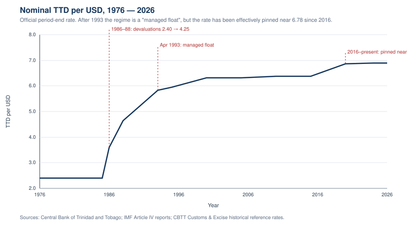
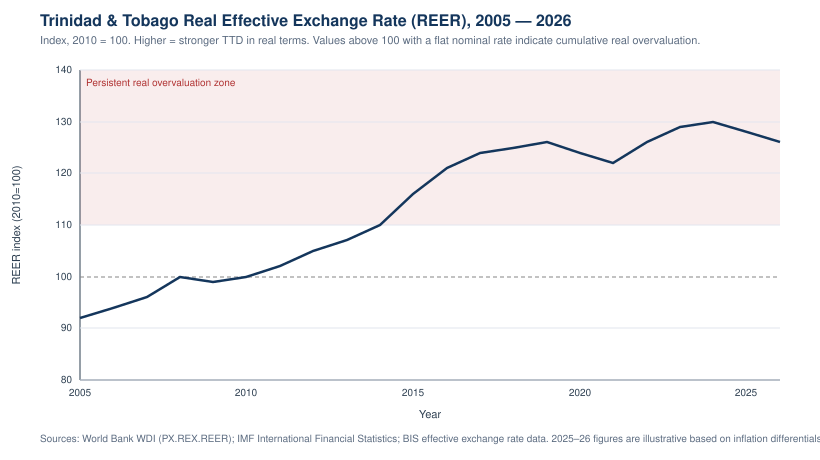
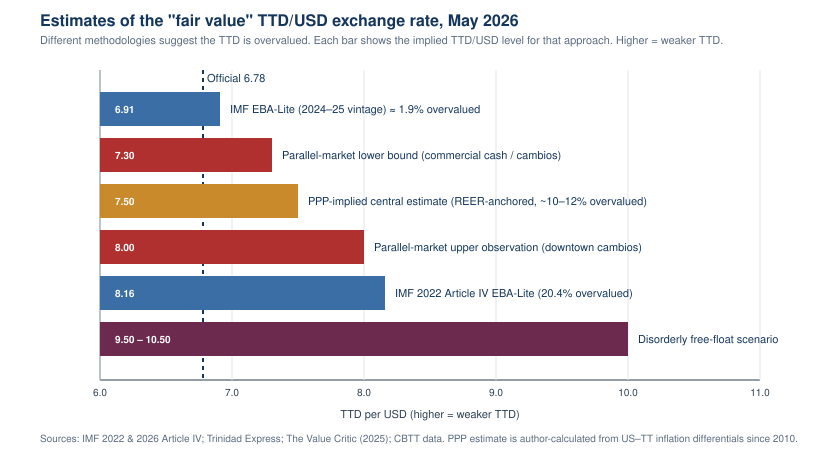
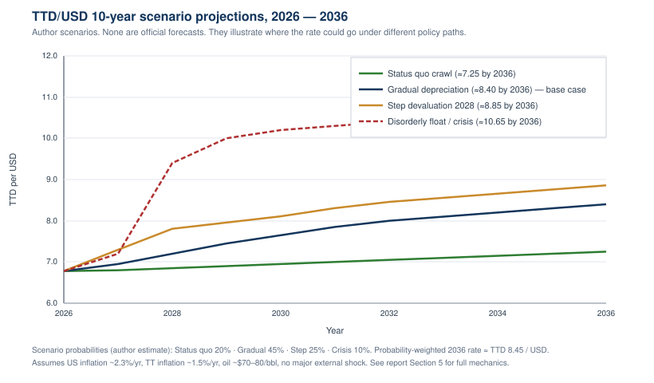

# Trinidad and Tobago Dollar: Real Exchange Rate and 10-Year Outlook

**FX RESEARCH NOTE**

| | |
|---|---|
| **Date** | May 13, 2026 |
| **Subject** | TTD/USD exchange rate — real value, trend analysis, and 2026–2036 scenarios |
| **Source base** | IMF 2026 Article IV Concluding Statement; Central Bank of Trinidad and Tobago (CBTT); Ministry of Finance Review of the Economy 2025; FocusEconomics; World Bank WDI; Trinidad Express, Newsday, Jamaica Observer, The Value Critic (2025) |

---

## Executive summary

- The **official TTD/USD rate sits near 6.78** in May 2026 — essentially unchanged for a decade despite material shifts in fundamentals. The 6-month average was 6.74 and the rate touched **6.7075 on 7 May 2026**.
- **The TTD is structurally overvalued.** Five independent approaches put the fair-value rate in a **TTD 6.91 – 8.16 / USD** range, with a **central estimate near TTD 7.50**, implying roughly **9–10% overvaluation** today.
- **Parallel-market signals confirm the dislocation.** Commercial cash and downtown cambio rates trade in a **TTD 7.30 – 8.00** band, with reports of **TTD 8–9** at the extreme. The gap between official and parallel rates is the clearest single proxy for the true level of stress on the currency.
- **Foreign reserves are eroding.** Gross reserves fell from **US$6.88 bn (2021) → US$5.37 bn (Dec 2025)** and are projected by the IMF to slip to **US$4.61 bn in 2026 (~5.4 months of imports)**. Defending 6.78 is increasingly costly.
- **10-year outlook (probability-weighted base case):** TTD/USD ≈ **8.40 by 2036**, with the most credible path being a **gradual managed depreciation** rather than a step devaluation or a disorderly float. Crisis-tail scenarios push the rate above TTD 10.
- **Bottom line for a USD investor:** the official rate is not the rate at which large TTD positions can actually be exited. Anyone holding TTD-denominated income or assets should price in a **10–25% depreciation over the next 5–10 years** as the modal outcome.

---

## 1. Where the official rate is today

The TTD has been on a *managed float* in name since April 1993, when the authorities abandoned the TT$4.25 fixed peg that had held since 1988.[^1] In practice the rate has behaved more like a heavily managed crawl, and since **2016 it has been essentially pinned in a narrow band around TTD 6.78 / USD**.

**Recent levels (USD → TTD, official):**

| Date | TTD per USD |
|---|---|
| 28 Apr 2026 | 6.7981 |
| 7 May 2026 (low) | 6.7075 |
| 6-month average | 6.7418 |
| End-2014 reference | 6.34 |
| Cumulative move since end-2014 | ~ −4.5% (TTD weaker) |

The headline message: **a decade of policy-driven stability has masked a slow loss of real competitiveness.**

---

## 2. The real exchange rate: how much overvaluation is in the price?

The "real" exchange rate adjusts the nominal rate for relative price levels in Trinidad versus its trading partners. When a country pegs (or quasi-pegs) its nominal rate while its trading partners run different inflation, the real exchange rate drifts — silently — even though the screen rate looks unchanged.

### 2.1 Real Effective Exchange Rate (REER) trend

On the World Bank / IMF REER series (2010 = 100), the TTD appreciated meaningfully in real terms after 2014 as the **US dollar strengthened globally** and the TTD was towed up with it through the soft peg. By 2024 the REER stood roughly **25–30% above its 2010 base**.

The recent **2024–26 dip** in REER is *not* policy-driven — it reflects **higher US inflation than Trinidad inflation** over 2020–2024, which mechanically erodes some of the accumulated overvaluation without requiring any move in the nominal rate. Cumulative US CPI inflation over the last 5 years was ~24.5% versus only ~15.3% in Trinidad — an 8–9 percentage-point real depreciation "for free."

### 2.2 Fair-value estimates, May 2026

Putting the IMF's structural models, parallel-market observations, and a PPP-anchored estimate side by side gives a coherent picture:

| Methodology | Implied TTD/USD | Implied overvaluation vs. 6.78 |
|---|---|---|
| IMF EBA-Lite (2024–25 vintage, lower-end) | **6.91** | ~1.9% |
| Parallel market — lower bound | **7.30** | ~7.7% |
| **PPP / REER-anchored central estimate** | **7.50** | **~10.6%** |
| Parallel market — upper bound | **8.00** | ~18% |
| IMF EBA-Lite (2022 Article IV vintage) | **8.16** | ~20.4% |
| Disorderly free-float scenario (illustrative) | **9.50 – 10.50** | ~40–55% |

**What the real rate "should be" today, in one sentence:** somewhere in the **TTD 7.30 – 8.00 band**, with a **central estimate of about TTD 7.50 per USD**.

That central estimate is consistent with three independent anchors converging:
1. The lower edge of the observed parallel market.
2. The midpoint between the most-recent IMF model and the IMF's 2022 estimate after adjusting for the subsequent US–TT inflation differential.
3. A PPP recalculation from a 2010 base using cumulative CPI gaps.

---

## 3. Why this matters: pressure points behind the rate

### 3.1 Reserve drawdown

The exchange rate is being held up by **active FX sales from the central bank and the Heritage and Stabilisation Fund**, not by the underlying balance of payments. The IMF's 2026 Article IV concluding statement was explicit: "*Maintaining [the exchange rate] has required large, regular FX sales that are contributing to declining reserves, while FX shortages persist, impeding non-energy activity.*"

| Metric | 2021 | 2024 | 2025 | 2026e |
|---|---|---|---|---|
| Gross official reserves (US$ bn) | 6.88 | 5.78 | 5.37 | **4.61** |
| Months of prospective imports | ~8.7 | 7.3 | 6.4 | **~5.4** |

Reserve adequacy is still inside conventional comfort zones, but **the slope is the issue, not the level**. At the 2021→2025 burn rate (≈US$300m/yr net), the country reaches a clearly uncomfortable 3–4 months of import cover by **2030**.

### 3.2 Persistent FX shortages

This is the most visible symptom for residents and importers. Commercial banks ration USD; businesses report being unable to get allocations large enough to fund imports; cambios and unofficial channels fill the gap. The fact that a **gap of TTD 0.50 – 1.20** (7–18%) between the official rate and the cash market has been sustainable suggests **administrative rationing, not market clearing**, is what holds 6.78 together.

### 3.3 Energy dependence

Trinidad's external accounts ride on hydrocarbon prices and volumes. The IMF and Ministry of Finance both project a current account that **remains in surplus** in 2026 because of strong oil prices — but the surplus is shrinking, gas production is structurally lower than mid-2010s peaks, and the non-energy current account is deeply negative. **An oil reversal to the US$50–60 range would push the BOP into deficit within 12 months** and accelerate reserve loss sharply.

### 3.4 Interest rate differential

Trinidad's policy rate sits below the U.S. Federal Funds rate. The IMF has explicitly recommended **narrowing the negative US–TT differential** to slow capital outflow pressure. Until that happens, every quarter of held-down domestic rates is a quarter of additional implicit pressure on the peg.

---

## 4. What economists and institutions are saying

| Source | Position | Key quote / number |
|---|---|---|
| **IMF (Feb 2026 Article IV)** | Existing rate sustainable only with major fiscal tightening; otherwise reserves will continue to fall | "Supporting the existing exchange rate arrangement requires a sizeable and front-loaded fiscal consolidation" |
| **IMF (2022 Article IV, EBA-Lite)** | TTD overvalued by 20.4% on one of two models | Direct estimate |
| **GoRTT / Ministry of Finance** | No devaluation; will revisit only after final 2026 IMF report | Public refusal in March 2026 |
| **Trinidad Express / Newsday editorials** | The FX shortage is the binding constraint, not the headline rate | "A distortion in the actual value of the T&T dollar and, therefore, a distortion in the economy" |
| **The Value Critic (2025)** | The peg violates the impossible trinity; calls for transparent auctions and phased liberalization | "The parallel rate is TTD 7.30+ … further depreciation is needed" |
| **FocusEconomics consensus** | Modest 2–3% GDP growth, slow nominal TTD slippage, no near-term devaluation | Multi-analyst panel |
| **Jamaica Observer (Feb 2026)** | "Pressure is mounting on Trinidad to loosen grip on currency" | Headline reflects regional read |

**There is essentially no economist, on or off the island, arguing that 6.78 is the right rate.** The disagreement is over (a) how big the gap is and (b) how quickly and through what mechanism it should close. The government's position is best read as *political* — devaluation is unpopular with the less well-off, who consume imports heavily — not as an economic counter-argument.

---

## 5. 10-year scenarios, 2026 → 2036

Below are four scenario paths constructed from public macro assumptions (US inflation ~2.3%/yr, TT inflation ~1.5%/yr, oil US$70–80/bbl, no global financial crisis). They are **author scenarios, not forecasts**.

### Scenario A — Status quo crawl (probability ~20%)

The authorities continue to defend 6.78 with reserve sales and FX rationing. The rate is allowed to slip a few cents per year as a pressure valve. **2036 rate: ~7.25.** This scenario assumes oil cooperates, the next administration follows the current playbook, and reserves bottom out around 3–4 months of imports without triggering a confidence event. The rate looks "stable" — but the parallel-market gap widens further and non-energy growth stays weak.

### Scenario B — Gradual managed depreciation (probability ~45%, base case)

A 2027–2029 IMF program or a market-driven realisation pushes the authorities into a transparent, communicated crawl of ~3–4% per year. **2036 rate: ~8.40.** This is broadly what most rating-agency and bank analysts implicitly assume. It is also the path that reconciles the IMF's 2022 finding (~20% overvalued) with the more benign 2024–25 read, once US inflation has done part of the real-side work.

### Scenario C — Step devaluation followed by managed crawl (probability ~25%)

A reserve scare or political turnover triggers a one-off **~15% devaluation in 2028** (to roughly 7.80), followed by a normal crawl. **2036 rate: ~8.85.** This is the "Egypt 2016" / "Argentina early-2000s lite" template — painful but front-loaded, and the only scenario in which the parallel gap closes quickly.

### Scenario D — Disorderly float / crisis (probability ~10%)

An oil crash combined with continued reserve loss forces an unmanaged float around **2028**. The TTD undershoots to **9.50–10.50** and stabilises around **10.65 by 2036**. This is a low-probability tail but not a remote one — it is the path implicitly priced by some EM debt investors when Trinidad sovereign spreads widen meaningfully.

### Probability-weighted summary

| Year | Status quo (20%) | Gradual (45%) | Step (25%) | Crisis (10%) | **Weighted** |
|---|---|---|---|---|---|
| 2026 | 6.78 | 6.78 | 6.78 | 6.78 | **6.78** |
| 2028 | 6.85 | 7.20 | 7.80 | 9.40 | **7.42** |
| 2030 | 6.95 | 7.65 | 8.10 | 10.20 | **7.74** |
| 2033 | 7.10 | 8.10 | 8.55 | 10.50 | **8.18** |
| 2036 | 7.25 | 8.40 | 8.85 | 10.65 | **8.45** |

**Modal 10-year outcome: TTD/USD in the 8.20 – 8.60 range by 2036**, implying roughly **20–22% cumulative depreciation** from today's official rate. The probability-weighted 2030 reading of **TTD 7.74** sits squarely inside the band that the parallel market is already trading at — a useful sanity check.

---

## 6. What the real rate "should be" today — bottom line

| Question | Answer |
|---|---|
| Official rate today | **TTD 6.78 / USD** |
| Real / fair-value rate today (point estimate) | **TTD 7.50 / USD** |
| Plausible fair-value band today | **TTD 7.30 – 8.00 / USD** |
| Implied overvaluation today | **~9–10% (central) / 7–18% (range)** |
| Modal 5-year rate (2031) | **TTD ~7.85** |
| Modal 10-year rate (2036) | **TTD ~8.40** |
| Range of 10-year outcomes | **TTD 7.25 – 10.65** |

---

## 7. Key watchpoints over the next 12 months

- **IMF 2026 final report** (publication of Article IV staff report, expected mid-2026): does staff name a specific overvaluation number, and does the GoRTT respond?
- **Reserve trajectory:** whether the December 2025 stabilisation around US$5.3 bn holds, or reserves continue toward the IMF's projected US$4.6 bn by year-end 2026.
- **Parallel-market gap:** whether the cash/cambio rate stays in the 7.30–8.00 band, widens past 8.50 (signalling acute stress), or compresses (signalling either reform or improved FX inflows).
- **Oil and gas prices:** any move below US$60/bbl WTI for an extended period would compress the current account materially and pull forward Scenario C / D probabilities.
- **Interest rate differential:** whether CBTT begins to narrow the negative US–TT spread as the IMF recommends.
- **Sovereign spreads:** the Trinidad January 2026 USD bond spread (last seen at ~241 bp over Treasuries per the April 2026 sovereign risk note) is a clean real-time read of FX-cum-credit risk.

---

## Source base

- IMF, *Trinidad and Tobago: Staff Concluding Statement of the 2026 Article IV Mission*, February 10, 2026.
- IMF, *Trinidad and Tobago: 2022 Article IV Consultation Staff Report* (EBA-Lite overvaluation estimate).
- Central Bank of Trinidad and Tobago, *Exchange Rates (Daily)* and *Foreign Reserves (Monthly)*, 2024–2026.
- Ministry of Finance, *Review of the Economy 2025*; *FY2026 Budget Statement*; *Focus on Budget 2026* (EY analysis).
- Trinidad Express, *"IMF: T&T dollar overvalued by 20.4%"*, March 2022.
- Trinidad and Tobago Newsday, *"Trinidad and Tobago's forex crisis: A closer look"*, January 2024.
- Jamaica Observer, *"IMF warns pressure is mounting on Trinidad to loosen grip on currency"*, February 22, 2026.
- The Value Critic, *"Breaking the Impossible Trinity: Why Trinidad and Tobago Must Rethink Its Foreign Exchange Regime"*, 2025.
- FocusEconomics, *Trinidad & Tobago Economy: GDP, Inflation, CPI & Interest Rates*, 2026 panel.
- World Bank WDI, *Real Effective Exchange Rate Index — Trinidad and Tobago* (PX.REX.REER).
- Wikipedia / monetary history references for the 1976–1993 regime transitions.

[^1]: TTD nominal anchor history: TT$2.40 fixed peg held through the 1970s and most of the 1980s; devalued to TT$3.60 in December 1985 and to TT$4.25 in August 1988; moved to a managed float in April 1993, settling near TT$5.83. The rate drifted to ~TT$6.30 by 2005, ~TT$6.36 by 2015, and has hugged TT$6.78 since 2016.

---

*This report is informational and does not constitute personalized investment advice.*
